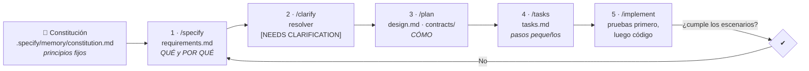
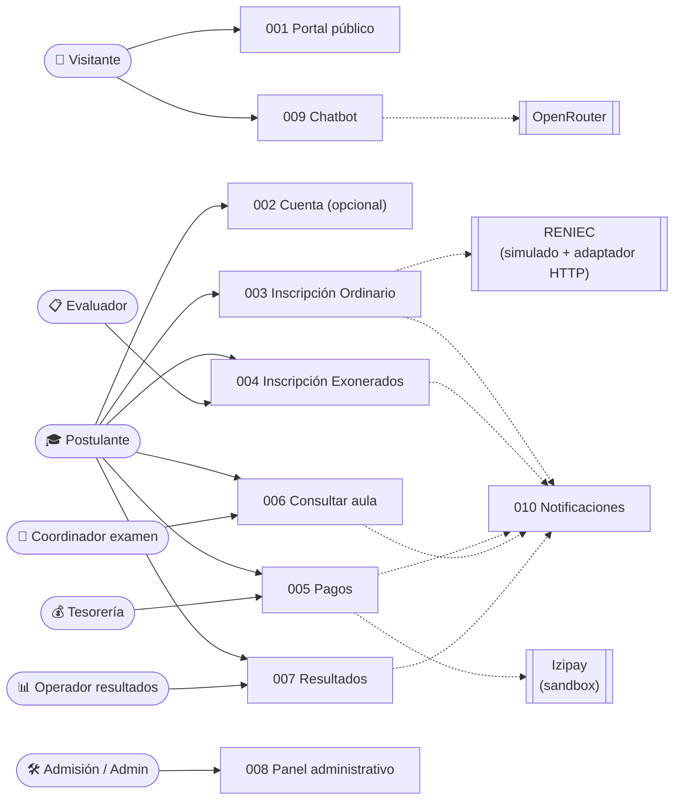

# SIA-UNSCH — Sistema Integral de Admisión

Proyecto académico del curso de **Arquitectura de Software** (UNSCH): rediseño y ampliación del portal de admisión `admision.unsch.edu.pe` (Concurso 2027-I), construido con **Spec-Driven Development (SDD)**: desarrollo guiado por especificaciones.

> Proyecto académico. No es el portal oficial de la Universidad Nacional de San Cristóbal de Huamanga.

---

## Cómo ejecutarlo (Windows, sin Docker)

Requisitos: **Node.js 22 o superior**. No se necesita Docker ni instalar PostgreSQL (ADR-014).

```bash
npm install
```

```bash
copy apps\backend\.env.example apps\backend\.env
```

```bash
npm run db:setup
```

```bash
npm run dev
```

- Web: http://127.0.0.1:4200 · API: http://127.0.0.1:3000/api/v1/health
- `db:setup` inicia PostgreSQL 16 embebido, aplica las migraciones y carga la semilla 2027-I (40 opciones, 1803 vacantes, 24 tasas).
- Los correos (códigos de verificación, recuperación) se guardan en `apps/backend/.dev-mail/`.
- Para inscribirte usa los **DNI de prueba** que muestra el formulario de inscripción (p. ej. `99900020`): autocompletan apellidos y nombres con una verificación simulada. Cualquier otro DNI se escribe a mano.
- Pruebas del backend (crea su propia base efímera): `npm test` · E2E de la inscripción por la interfaz: `node scripts/e2e-inscripcion.mjs`

### Usar tu base de datos Amazon RDS

1. En la consola de RDS confirma **Acceso público: Sí** (solo para desarrollo) y que el grupo de seguridad permita el puerto **5432 desde tu IP**.
2. Copia la plantilla y escribe tu contraseña en `DATABASE_URL` (el host ya está puesto):

```bash
copy apps\backend\.env.rds.example apps\backend\.env.rds
```

3. Comprueba la conexión (SSL verificado con `apps/backend/certs/global-bundle.pem`):

```bash
npm run rds:check
```

4. Crea la base `admision_unsch`, aplica las migraciones y carga la semilla 2027-I (la CLI de Prisma en Windows usa SChannel, que solo lee un certificado; por eso las migraciones verifican con la raíz de la región, `certs/rds-us-east-2-root.pem`, vía `DB_SSL_ROOT_CERT`):

```bash
npm run rds:setup
```

5. Ejecuta el sistema contra RDS:

```bash
npm run dev:rds
```

> Verificado el 25/10/2026: PostgreSQL 18.3 en RDS, migraciones aplicadas, semilla 2027-I (40 opciones, 1803 vacantes) y E2E de inscripción OK. Cada consulta tarda ~0,7–2 s desde Perú hasta us-east-2; apaga la instancia cuando no la uses.

### Panel administrativo (ADR-018)

Entra en **http://127.0.0.1:4200/admin**. El primer administrador lo crea la semilla: su correo y su contraseña temporal están en `apps/backend/.admin-inicial.txt` (ignorado por git; bórralo después de entrar).

1. Escribe el correo y la contraseña temporal; el sistema te pide una contraseña nueva.
2. Escanea el código QR con Google Authenticator o Microsoft Authenticator y escribe los 6 dígitos. Desde entonces cada ingreso pide la contraseña y el código del teléfono.
3. En «Usuarios y roles» crea al resto del personal (Oficina de Admisión, Tesorería, Evaluador, Coordinador de examen, Operador de resultados, Soporte, Auditor); cada uno ve solo las secciones de su rol.

Prueba automática (solo contra la base local): `node scripts/e2e-panel.mjs`.

### Asistente virtual con IA (ADR-017)

El botón **Asistente de Admisión** aparece en todas las páginas. Sin clave responde en **modo básico** (reglas + datos oficiales). Para activar la IA:

1. Crea una clave en *openrouter.ai → Keys* y escríbela en `OPENROUTER_API_KEY` de `apps/backend/.env.rds` (solo en el servidor). Guarda el archivo.
2. Opcional: `OPENROUTER_MODEL` (por defecto `anthropic/claude-haiku-5.5`) y `CHAT_DAILY_BUDGET_USD` (tope diario, por defecto US$ 1).
3. Reinicia la API. Prueba: `node scripts/e2e-asistente.mjs`.

### Pagos en línea con Izipay (ADR-016)

1. En `apps/backend/.env.rds` completa `IZIPAY_MERCHANT_CODE`, `IZIPAY_API_KEY` (clave de API del nuevo botón de pagos), `IZIPAY_HASH_KEY` y, si la tienes, `IZIPAY_PUBLIC_KEY` (*sandbox-panel.izipay.pe → Desarrolladores → Claves*). **Guarda el archivo.**
2. Comprueba las credenciales (pide un token de sesión de prueba; no cobra nada):

```bash
npm run izipay:check
```

3. Cambia `PAYMENTS_PROVIDER=mock` por `PAYMENTS_PROVIDER=izipay` y vuelve a ejecutar `npm run dev:rds`. En «Imprimir documentos», el botón **Pagar** abre el formulario de Izipay (ambiente de pruebas).
4. Para aplicar migraciones nuevas en RDS sin recargar la semilla: `npm run rds:migrate`.

Sin credenciales (`PAYMENTS_PROVIDER=mock`) el mismo botón abre una **pasarela simulada** que firma la respuesta igual que Izipay; así se prueba todo el flujo (`node scripts/e2e-pago.mjs`).

## 1. Spec-Driven Development en este proyecto

La **especificación es la fuente de verdad**; el código se deriva de ella. Cada funcionalidad tiene en `specs/NNN-…/` los **tres artefactos SDD**:

| Artefacto | Pregunta | Contenido |
|---|---|---|
| **`requirements.md`** | ¿Qué necesita el usuario y por qué? | Historias de usuario, escenarios Dado/Cuando/Entonces, requisitos funcionales (FR) que citan los RF y las reglas del Reglamento, criterios de éxito y el estado actual de cada RF |
| **`design.md`** | ¿Cómo se construye? | Plan técnico, decisiones, modelo de datos, contratos de la API (`contracts/`), guía de validación y cambios de diseño |
| **`tasks.md`** | ¿En qué orden y en qué archivos? | Tareas pequeñas y verificables, marcadas `[x]` al terminarlas |

Cada funcionalidad recorre estas fases y no avanza a la siguiente sin aprobar la anterior:



| Fase | Pregunta que responde | Artefacto | Quién lo valida |
|---|---|---|---|
| Constitución | ¿Qué reglas nunca se rompen? | `constitution.md` | Equipo |
| Especificar | ¿Qué necesita el usuario y por qué? | `requirements.md` (historias, escenarios Dado/Cuando/Entonces, requisitos FR, criterios de éxito) | Usuario / Admisión |
| Clarificar | ¿Qué falta saber? | Marcas `[NEEDS CLARIFICATION]` resueltas | Usuario |
| Diseñar | ¿Cómo se construye? | `design.md` (plan, decisiones, modelo de datos, validación) + `contracts/` | Arquitecto |
| Tareas | ¿En qué orden y en qué archivos? | `tasks.md` | Equipo |
| Implementar | ¿Funciona como se especificó? | Código + pruebas | Pruebas automáticas |

---

## 2. Estructura del repositorio

```text
proyectofinal/
├── .specify/
│   ├── memory/
│   │   └── constitution.md          # Principios no negociables, stack, RNF y gobernanza
│   └── templates/
│       ├── requirements-template.md # Plantilla de requisitos (QUÉ)
│       ├── design-template.md       # Plantilla de diseño (CÓMO)
│       ├── tasks-template.md        # Plantilla de tareas
│       └── checklist-template.md    # Lista de calidad de la especificación
├── specs/                           # Una carpeta por funcionalidad = una rama Git
│   ├── 001-portal-publico/
│   │   ├── requirements.md          # 1 · Requisitos: qué y por qué (+ estado de cada RF)
│   │   ├── design.md                # 2 · Diseño: plan, decisiones, modelo de datos, validación
│   │   ├── contracts/openapi.yaml   #     Contrato de la API (parte del diseño)
│   │   └── tasks.md                 # 3 · Tareas verificables
│   ├── 002-cuentas-identidad/       # Misma estructura: requirements · design · tasks
│   ├── 003-inscripcion-ordinaria/
│   ├── 004-inscripcion-exonerados/
│   ├── 005-pagos/
│   ├── 006-examen-aulas/
│   ├── 007-resultados-ingreso/
│   ├── 008-panel-administrativo/
│   ├── 009-chatbot-ia/
│   └── 010-notificaciones/
├── docs/
│   ├── vision.md                    # Propósito, alcance, actores, análisis del portal actual, mejoras MEJ
│   ├── reglas-negocio.md            # Reglas RN del Reglamento 2027-I y catálogos oficiales
│   ├── arquitectura.md              # C4 (contexto, contenedores, componentes), despliegue AWS, calidad
│   ├── adr/                         # 13 decisiones de arquitectura (ADR-001…ADR-013)
│   └── fuentes/                     # PDF oficiales, guía maestra y capturas del portal actual
├── apps/                            # Código (desde el Paso 5)
│   ├── frontend/                    #   Angular
│   └── backend/                     #   Node.js + Express + TypeScript (API + worker)
├── packages/contracts/              # Esquemas Zod y DTO compartidos
├── infra/                           # AWS CDK (Network, Data, Api, Web)
└── README.md
```

---

## 3. Mapa de funcionalidades

Las **funcionalidades** (`specs/`) son cortes verticales que se entregan y demuestran solas. Los **módulos** (`M01`–`M14`) son la organización interna del código del monolito modular; una funcionalidad puede tocar varios módulos.

| # | Funcionalidad | Módulos | Historias | P1 | Requisitos FR | Depende de |
|---|---|---|--:|--:|--:|---|
| 001 | [Portal público](specs/001-portal-publico/requirements.md) | M01, M14 | 6 | 3 | 13 | — |
| 002 | [Cuentas e identidad](specs/002-cuentas-identidad/requirements.md) | M02, M13 | 6 | 4 | 13 | — |
| 003 | [Inscripción Ordinario](specs/003-inscripcion-ordinaria/requirements.md) | M03, M05, M06 | 7 | 5 | 16 | 001, 002 |
| 004 | [Inscripción Exonerados y expediente](specs/004-inscripcion-exonerados/requirements.md) | M04, M06 | 7 | 5 | 15 | 002, 003 |
| 005 | [Pagos y conciliación](specs/005-pagos/requirements.md) | M05 | 5 | 2 | 12 | 003 |
| 006 | [Examen, aulas y asistencia](specs/006-examen-aulas/requirements.md) | M07, M08 | 6 | 4 | 13 | 005 |
| 007 | [Resultados e ingreso](specs/007-resultados-ingreso/requirements.md) | M09 | 7 | 4 | 11 | 006 |
| 008 | [Panel administrativo, seguridad y reportes](specs/008-panel-administrativo/requirements.md) | M01, M12, M13, M14 | 8 | 3 | 14 | 002 |
| 009 | [Asistente virtual (chatbot IA)](specs/009-chatbot-ia/requirements.md) | M10 | 5 | 1 | 11 | 001, 002 |
| 010 | [Notificaciones](specs/010-notificaciones/requirements.md) | M11 | 5 | 1 | 8 | 002 |
| | **Total** | **14 módulos** | **62** | **32** | **126** | |

**Prioridades:** P1 = imprescindible para el MVP · P2 = importante · P3 = deseable.
**Trazabilidad:** los **143 requisitos RF-01.01…RF-14.10 de los 14 módulos** de la guía maestra están citados en al menos un FR de las especificaciones; cada FR cita además su regla del Reglamento (`RN`) o mejora (`MEJ`). La [matriz de trazabilidad](docs/trazabilidad-requisitos.md) muestra, módulo por módulo, qué spec cubre cada RF y su estado en el código (hoy: ✅ 134 · 🟡 9 · ⏳ 0; los 9 parciales dependen de servicios externos: RENIEC, Izipay, OpenRouter, Amazon SES y AWS). Se regenera con `node scripts/trazabilidad.mjs`.

### Actores y funcionalidades (vista de casos de uso)



### Recorrido del MVP (solo historias P1)

Visitante consulta convocatoria, vacantes y tasa (001) → se inscribe sin cuenta y sube foto (003; la cuenta de 002 es opcional) o envía expediente y es autorizado (004) → paga en línea con Izipay sandbox (005) → descarga ficha con QR → consulta su aula (006) → ve su resultado (007).

---

## 4. Hoja de ruta paso a paso

| Paso | Entregable | Estado |
|---|---|---|
| 1 | Constitución, visión, análisis del portal actual, reglas de negocio | ✅ Aprobado |
| 2 | Estructura SDD + requisitos (hoy `requirements.md`) de las 10 funcionalidades (historias, escenarios, FR, criterios de éxito) y RNF en la constitución | ✅ Aprobado |
| 3 | `/clarify` (5 aclaraciones) + [arquitectura C4](docs/arquitectura.md) + [13 ADR](docs/adr/README.md) | ✅ Aprobado |
| 4 | `/plan` de [001](specs/001-portal-publico/design.md) y [002](specs/002-cuentas-identidad/design.md): diseño técnico, decisiones, modelo de datos, `contracts/openapi.yaml` y guía de validación | ✅ Aprobado |
| **5** | **`/tasks` + `/implement` de 001 y 002: monorepo, PostgreSQL embebido, API (M01, M02, M13, M14), portal público y cuentas en Angular con sistema de diseño UNSCH; 92 pruebas del backend y E2E de cuentas por la interfaz** | ✅ Listo para revisión |
| **5.1** | **Ajustes pedidos: inscripción pública sin cuenta ([ADR-015](docs/adr/ADR-015-inscripcion-sin-cuenta.md)) con el formulario oficial y autocompletado por DNI, documentos oficiales como PDF dentro de la web con menú «Contenido», consulta con DNI + código, conexión a RDS con SSL verificado** | ✅ Listo para revisión |
| **5.2** | **Catálogo oficial de 14 módulos y 143 RF: [matriz de trazabilidad](docs/trazabilidad-requisitos.md) con estado por requisito; [ADR-016](docs/adr/ADR-016-pasarela-izipay.md) Izipay sandbox; enmienda de ADR-015 (cuenta opcional del postulante); RF-14.10 respaldos en spec 008** | ✅ Listo para revisión |
| **5.3** | **Pagos en línea (spec 005, iteración 1): módulo M05 con Izipay ([ADR-016](docs/adr/ADR-016-pasarela-izipay.md)) y pasarela simulada, firma HMAC verificada en el servidor, IPN idempotente, constancia e historial en «Imprimir documentos»; inscripción a Apta por evento. Falta el pago real en sandbox (faltan credenciales)** | 🟡 Listo, salvo sandbox |
| **5.4** | **Asistente virtual (spec 009, M10): OpenRouter con herramientas sobre datos oficiales ([ADR-017](docs/adr/ADR-017-asistente-ia-herramientas.md)), modo básico sin clave, «Consultar mi proceso» con pase firmado, derivación a una persona, control de uso y retención; 128 pruebas del backend y E2E del asistente** | ✅ Listo para revisión |
| **5.5** | **Panel administrativo (spec 008, adelantado a pedido): ingreso del personal con contraseña + TOTP ([ADR-018](docs/adr/ADR-018-panel-acceso-personal.md)), 8 roles con permisos verificados y auditados, convocatoria (fechas, tasas, vacantes con resolución, copia), inscripciones, pagos, contenido, asistente, casos, inhabilitados, usuarios, auditoría, configuración e indicadores exportables a Excel y PDF; 143 pruebas del backend y E2E del panel** | ✅ Listo para revisión |
| 6 | Cuenta opcional del postulante (crear con DNI + dígito verificador, código por correo, ingresar, recuperar, «Mi cuenta» con las inscripciones del mismo DNI), borrador automático de la inscripción y ficha de inscripción en PDF con QR firmado y verificación pública; 147 pruebas del backend y E2E de pago, ficha y cuenta | ✅ Aprobado |
| 7 | Exonerados y expedientes (M04, M06): expediente en línea en «Imprimir documentos» (carga validada de PDF/JPG/PNG, datos de la submodalidad, envío), bandeja del evaluador en el panel (conforme u observado por documento, autorizar/observar/rechazar, verificación presencial, evaluación especial, reasignación), subsanación en 72 h, pago bloqueado hasta autorizar, correos y expedientes por estado en el indicador; 154 pruebas del backend y E2E del expediente | ✅ Aprobado |
| 8 | ~~Panel administrativo~~ — adelantado como Paso 5.5; la edición de modalidades, programas y requisitos se completó en el Paso 10.2 | ✅ Adelantado |
| 9 | Exámenes, sedes y aulas (M07, M08): programación con ventana de ingreso, estructura, calificación e indicaciones; sedes, pabellones y aulas con capacidad y accesibilidad; control de cruces; distribución automática todo o nada (adecuaciones primero), confirmación y publicación 24 h antes; «Buscar aula» y ficha de examen con QR; asistencia por QR con foto, fuera de hora, ausentes e incidencias; cambios de aula y reprogramación con correo; 22 pruebas nuevas y E2E del examen | ✅ Aprobado |
| 10 | Resultados (M09): importación validada de la lectora, puntaje y orden de mérito con empates, mínimo 450, sin derecho a vacante y traslado de vacantes de exonerados; versiones con aprobación de otra persona y publicación a la hora autorizada; «Ver puntaje», lista de admitidos sin DNI, ingreso con constancia y QR, admisión perdida, reportes y revisión por error material. Notificaciones (M11): registro de cada correo, cola con reintentos sin duplicar, recordatorios, aulas publicadas, resultados disponibles, comunicados segmentados, plantillas y bandeja del postulante. Tesorería (M05): conciliación y anulaciones por error de cobro; 28 pruebas nuevas y E2E de resultados | ✅ Aprobado |
| 10.1 | ~~Rediseño con las skills de diseño~~ — revertido a pedido el 27/10/2026: el portal y el panel vuelven al diseño anterior (Archivo, guinda y dorado) y se retiraron las fotos del retablo y de la catedral | ↩️ Revertido |
| **10.2** | **Los 17 requisitos parciales sin dependencias externas: catálogo del concurso editable (modalidades, tipos, submodalidades con criterios, facultades, áreas, programas y requisitos), imágenes de la portada editables, documentos adicionales de la inscripción, consentimiento en la inscripción, anonimización por retención, temario por curso en el examen, asistencia sin conexión, aviso de anulación, asistente con expediente/aula/resultado y exportación de expedientes y asistencia; 212 pruebas del backend** | ✅ Listo para revisión |
| 11 | Despliegue en AWS con CDK (Lambda, API Gateway, RDS, CloudFront) — **requiere confirmar costos** — y pruebas finales | ⏳ |

### Aclaraciones (`/clarify`, sesión 25/10/2026)

| Tema | Decisión | Registrada en |
|---|---|---|
| Tabla 5 (ponderación) | Provisional uniforme: 9 pts por pregunta de conocimientos y 5 por pregunta de test, factor 1.0 configurable | spec 007, RN-34, ADR-011 |
| Recargo CEPRE extemporáneo | S/ 50.00 (regla específica del cronograma) | spec 004, `reglas-negocio.md` §3 |
| Códigos de programas | Código interno `P01`–`P40` + código oficial como atributo | spec 001, DQ-1 |
| Despliegue | Debe quedar desplegado en AWS | Constitución IV, ADR-009 |
| Observabilidad | Sin CloudWatch: OpenTelemetry + Grafana Cloud (registros, trazas, métricas y alertas) | ADR-013 |
| Cuenta del postulante | No se exige para inscribirse; «Mi cuenta» opcional para borrador, historial y chatbot | ADR-015 (enmienda) |
| Pasarela de pagos | Izipay, ambiente sandbox para la demo | ADR-016, spec 005 |

---

## 5. Documentación de referencia

- [Constitución](.specify/memory/constitution.md)
- [Arquitectura (C4 y despliegue AWS)](docs/arquitectura.md)
- [Decisiones de arquitectura (ADR)](docs/adr/README.md)
- [Trazabilidad de los 143 requerimientos funcionales (14 módulos)](docs/trazabilidad-requisitos.md)
- [Visión y análisis del portal actual](docs/vision.md)
- [Reglas de negocio y catálogos 2027-I](docs/reglas-negocio.md)
- [Fuentes oficiales](docs/fuentes/)
