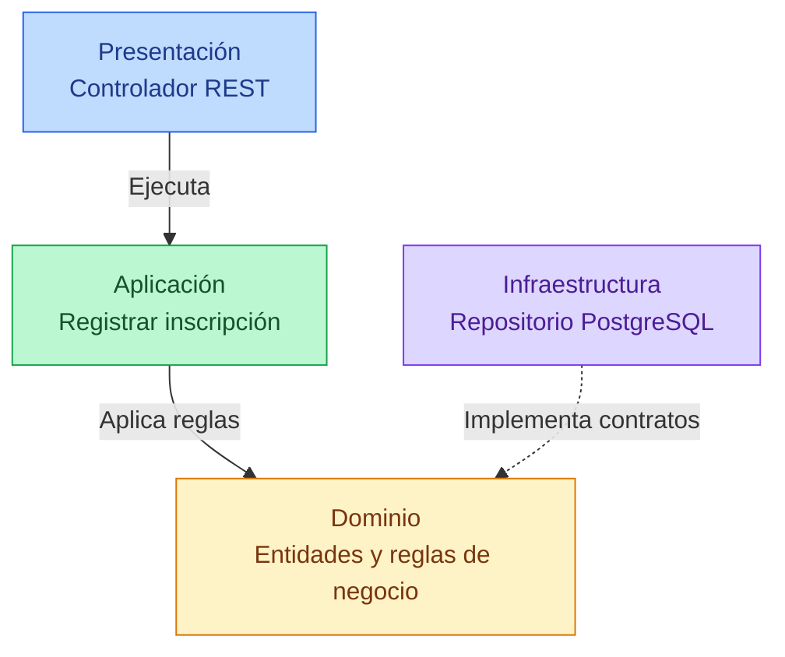

# 7. Diseño Interno de Módulos

## 7.1. Descripción general

El Sistema Integral de Gestión del Proceso de Admisión UNSCH estará desarrollado bajo una arquitectura de **Monolito Modular por Capas**, aplicando los principios de **Clean Architecture**.

Esta arquitectura permitirá organizar las funcionalidades del sistema en módulos independientes a nivel lógico, pero integrados dentro de una única aplicación backend desarrollada con Node.js y TypeScript.

El backend podrá desplegarse mediante AWS Lambda y comunicarse con la aplicación Angular a través de Amazon API Gateway.

El objetivo principal de este diseño es separar las responsabilidades de cada módulo, facilitar el mantenimiento del código y permitir la incorporación de nuevas funcionalidades sin afectar innecesariamente a los demás componentes.

## 7.2. Organización interna de los módulos

Cada módulo funcional seguirá una estructura de cuatro capas, con responsabilidades claramente definidas.

### Capa de presentación

Se encargará de recibir las solicitudes HTTP provenientes de la aplicación Angular.

Contendrá los controladores REST y las rutas necesarias para acceder a las funcionalidades del módulo. También permitirá validar los datos de entrada y devolver las respuestas correspondientes.

### Capa de aplicación

Contendrá los casos de uso encargados de coordinar los procesos del sistema.

Por ejemplo, en el módulo de Inscripción Ordinaria, esta capa ejecutará el proceso de registro, solicitará la validación de requisitos y coordinará el almacenamiento de la inscripción.

### Capa de dominio

Contendrá las entidades, reglas de negocio e interfaces necesarias para representar el funcionamiento del módulo.

Esta capa será independiente de tecnologías como PostgreSQL, AWS Lambda o frameworks de desarrollo, permitiendo que las reglas de negocio puedan mantenerse sin depender de la infraestructura.

### Capa de infraestructura

Implementará los repositorios y adaptadores necesarios para comunicarse con la base de datos y los servicios externos.

Por ejemplo, permitirá guardar inscripciones en Amazon RDS PostgreSQL y acceder a servicios como RENIEC o la pasarela de pagos cuando el proceso lo requiera.

## 7.3. Diagrama de diseño interno

Para representar la organización interna se utiliza como ejemplo el módulo de **Inscripción Ordinaria**.



**Interpretación del diagrama:**

La capa de presentación recibe las solicitudes del usuario y las envía a la capa de aplicación. Esta coordina el caso de uso y aplica las reglas definidas en el dominio.

La infraestructura implementa los contratos necesarios para almacenar y consultar información, evitando que el dominio dependa directamente de PostgreSQL.

## 7.4. Estructura de carpetas

Para mantener una organización uniforme, los módulos utilizarán la siguiente estructura de carpetas.

```text
apps/backend/src/
├── modules/
│   ├── convocatorias/        M01 (repositorio PrismaConvocatoriasRepository)
│   ├── usuarios/             M02 (identidad RENIEC, cuentas, personal)
│   ├── inscripciones/        M03
│   │   ├── domain/
│   │   │   └── inscription-rules.ts        estados, estado inicial, enmascarado del DNI
│   │   ├── application/
│   │   │   ├── inscription-service.ts      registrar, consultar, reinscribir, anular
│   │   │   ├── ficha-service.ts            ficha PDF con QR firmado
│   │   │   ├── orden-pago-pdf.ts           orden de pago en PDF
│   │   │   ├── application-documents.ts    documentos adicionales
│   │   │   └── cepre-awardees.ts           ingresantes CEPRE
│   │   ├── presentation/
│   │   │   └── routes.ts                   rutas REST y validación con Zod
│   │   └── index.ts                        raíz de composición y API pública del módulo
│   ├── pagos/                M04 (domain/ports.ts + infrastructure/ con 4 pasarelas)
│   ├── expedientes/          M05
│   ├── examenes/             M06 (exámenes, sedes, pabellones y aulas)
│   ├── resultados/           M07
│   ├── asistente/            M08 (Chatbot IA con OpenRouter)
│   ├── notificaciones/       M09
│   ├── reportes/             M10
│   ├── seguridad/            M11 (permisos, tokens, TOTP)
│   └── configuracion/        M12
├── shared/                   audit, clock, config, db, email, events (outbox), http,
│                             rate-limit, storage (S3), telemetry, text
├── app.ts                    composición de la aplicación Express
├── server.ts                 arranque local
├── lambda-api.ts             punto de entrada en AWS Lambda (API)
└── lambda-worker.ts          punto de entrada en AWS Lambda (tareas programadas)
```

Cada módulo contará con sus propios componentes internos. La carpeta `shared` almacenará únicamente elementos comunes que puedan reutilizarse sin generar dependencias innecesarias entre módulos.

La estructura propuesta al inicio (`inscripcion-ordinaria/`, `dominio/`, `registrar-inscripcion.use-case.ts`, `inscripcion-ordinaria.module.ts`) se adaptó durante la implementación: las carpetas usan nombres en inglés para las capas (`domain`, `application`, `presentation`, `infrastructure`), cada módulo expone su API en `index.ts` (que también es su raíz de composición) y los casos de uso de un mismo módulo se agrupan en un servicio (`InscriptionService`) en lugar de una clase por caso de uso.

## 7.5. Funcionamiento del módulo Inscripción Ordinaria

El módulo de Inscripción Ordinaria permitirá registrar la postulación de un estudiante a una convocatoria de admisión.

El proceso seguirá la siguiente secuencia:

1. **Registro de información:** el postulante completará el formulario de inscripción desde la aplicación Angular.

2. **Recepción de solicitud:** Amazon API Gateway enviará la solicitud al backend, donde será procesada por el controlador REST.

3. **Validación de requisitos:** el caso de uso verificará que el postulante cumpla las condiciones establecidas para la convocatoria.

4. **Verificación de duplicados:** el sistema comprobará que no exista una inscripción previa para el mismo postulante y convocatoria.

5. **Aplicación de reglas de negocio:** el dominio creará la inscripción con el estado inicial correspondiente.

6. **Almacenamiento:** el servicio guarda la inscripción en Amazon RDS PostgreSQL en una transacción, junto con el evento `InscripcionRegistrada` en la bandeja de eventos.

7. **Respuesta al usuario:** el sistema devolverá el código de inscripción y su estado actual.

Inicialmente, la inscripción tendrá el estado **PENDIENTE_PAGO** (Ordinario y CEPRE) o **PENDIENTE_VALIDACION** (Exonerados, hasta que se autorice su expediente). Cuando la pasarela confirma el pago, el módulo Pagos publica el evento `PagoConfirmado` y el módulo Inscripciones, suscrito a ese evento, cambia el estado a **APTA**. Los otros estados son **OBSERVADA** y **ANULADA**.

## 7.6. Módulos funcionales del sistema

El sistema está compuesto por 12 módulos funcionales, uno por carpeta, dentro de una única aplicación backend.

| Código | Módulo | Responsabilidad principal | Carpeta |
|---|---|---|---|
| M01 | Convocatorias | Gestionar periodos, cronogramas y procesos de admisión. | `convocatorias` |
| M02 | Usuarios | Registrar usuarios y gestionar sus datos. | `usuarios` |
| M03 | Inscripciones: Ordinaria y Exonerados | Administrar las postulaciones de todas las modalidades. | `inscripciones` |
| M04 | Pagos | Registrar y verificar los pagos de inscripción. | `pagos` |
| M05 | Expedientes | Administrar documentos y observaciones. | `expedientes` |
| M06 | Exámenes, Sedes y Aulas | Programar las evaluaciones, y gestionar ambientes y asignaciones. | `examenes` |
| M07 | Resultados | Procesar y publicar resultados de admisión. | `resultados` |
| M08 | Chatbot IA | Orientar a los postulantes mediante OpenRouter API. | `asistente` |
| M09 | Notificaciones | Enviar avisos y correos electrónicos. | `notificaciones` |
| M10 | Reportes | Generar estadísticas e informes. | `reportes` |
| M11 | Seguridad | Administrar autenticación, roles y permisos. | `seguridad` |
| M12 | Configuración | Gestionar parámetros generales del sistema. | `configuracion` |

**Equivalencia con la numeración anterior.** Las specs, los ADR, los comentarios del código y los códigos RF conservan los números del catálogo original de 14 módulos:

| Antes | Ahora | Antes | Ahora |
|---|---|---|---|
| M01 Convocatorias | M01 | M08 Sedes y Aulas | M06 |
| M02 Usuarios | M02 | M09 Resultados | M07 |
| M03 Inscripción Ordinaria | M03 | M10 Chatbot IA | M08 |
| M04 Inscripción Exonerados | M03 | M11 Notificaciones | M09 |
| M05 Pagos | M04 | M12 Reportes | M10 |
| M06 Expedientes | M05 | M13 Seguridad | M11 |
| M07 Exámenes | M06 | M14 Configuración | M12 |

Cada módulo tendrá responsabilidades específicas y se comunicará con los demás mediante interfaces definidas, evitando dependencias directas innecesarias.

## 7.7. Integración con la infraestructura AWS

El sistema utilizará diferentes servicios tecnológicos para ejecutar sus funcionalidades.

| Tecnología | Función |
|---|---|
| Angular | Desarrollo de la interfaz web. |
| Node.js y TypeScript | Implementación del backend modular. |
| Amazon API Gateway | Recepción de solicitudes REST mediante HTTPS. |
| AWS Lambda | Ejecución del backend. |
| Amazon RDS PostgreSQL | Almacenamiento de información. |
| Amazon S3 | Almacenamiento de documentos y fichas PDF. |
| Bandeja de eventos (outbox) en PostgreSQL + Amazon SQS | Procesamiento de tareas asíncronas y eventos entre módulos. |
| Amazon EventBridge Scheduler | Tareas programadas. |
| RENIEC (vía apiperu.dev) | Validación de identidad. |
| Culqi | Pago con tarjeta y con Yape (ADR-024). |
| OpenRouter API | Integración del chatbot de inteligencia artificial. |
| Amazon SES | Envío de correos electrónicos. |

La comunicación con estos servicios se realizará mediante adaptadores implementados en la capa de infraestructura.

Los servicios de caché y mensajería podrán incorporarse progresivamente de acuerdo con las necesidades del sistema.

## 7.8. Reglas de diseño

Para mantener una estructura organizada se establecerán las siguientes reglas:

1. Cada módulo tendrá responsabilidades claramente definidas.
2. La lógica de negocio permanecerá separada de la infraestructura.
3. Los controladores REST no accederán directamente a la base de datos.
4. Los casos de uso coordinarán los procesos del sistema.
5. Los repositorios implementarán las interfaces definidas en las capas internas.
6. Los módulos evitarán dependencias circulares.
7. Todas las funcionalidades se integrarán en un único backend desplegable.

Estas reglas permitirán aplicar los principios de Clean Architecture dentro del Monolito Modular por Capas.

## 7.9. Conclusión

El diseño interno de módulos permitirá desarrollar el Sistema Integral de Gestión del Proceso de Admisión UNSCH de manera organizada, modular y mantenible.

La aplicación de Clean Architecture facilitará la separación entre las reglas de negocio y los detalles tecnológicos, mientras que el Monolito Modular por Capas permitirá integrar las funcionalidades dentro de una sola aplicación backend.

Esta propuesta simplificará el desarrollo, las pruebas y el despliegue del sistema, además de facilitar futuras mejoras y ampliaciones.

## 7.10. Estado de implementación (02/11/2026)

| Regla de diseño (7.8) | Estado |
|---|---|
| 1. Responsabilidades claras por módulo | ✅ 12 módulos, uno por carpeta |
| 2. Lógica de negocio separada de la infraestructura | 🟡 Las reglas están en `domain/` y los proveedores externos detrás de puertos; pero los servicios de aplicación consultan la base de datos con Prisma directamente |
| 3. Controladores sin acceso directo a la base de datos | ✅ Ninguna ruta de `presentation/` consulta la base de datos |
| 4. Los casos de uso coordinan los procesos | ✅ Servicios de aplicación por módulo |
| 5. Repositorios que implementan interfaces internas | 🟡 En Convocatorias (`ConvocatoriasRepository` → `PrismaConvocatoriasRepository`), Inscripciones (`InscriptionRepository` → `PrismaInscriptionRepository`, con unidad de trabajo para las transacciones) y Pagos (`PaymentRepository` → `PrismaPaymentRepository`); pendiente en los demás módulos |
| 6. Sin dependencias circulares | ✅ Los módulos se comunican por su `index.ts` o por eventos |
| 7. Un único backend desplegable | ✅ Un backend con dos puntos de entrada en Lambda: API y tareas programadas |

