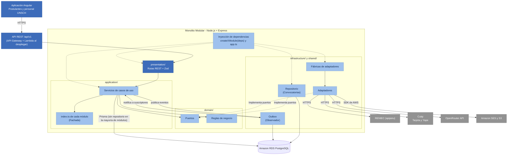

# Patrones de Diseño

## Sistema Integral de Gestión del Proceso de Admisión – UNSCH

## 1. Objetivo

Documentar los patrones de diseño aplicados en el backend del Sistema Integral de Gestión del Proceso de Admisión – UNSCH, indicando dónde se utilizan, qué problemas resuelven y con qué tecnologías se implementan, para garantizar un desarrollo organizado, mantenible y uniforme.

## 2. Contexto

- **Estilo arquitectónico:** Monolito Modular por Capas.
- **Enfoque interno:** Clean Architecture.
- **Backend:** Node.js + TypeScript + Express.
- **Despliegue:** AWS Lambda.
- **Comunicación:** API REST mediante HTTPS.
- **Base de datos:** Amazon RDS PostgreSQL.
- **Caché:** no se usa por ahora; Redis queda previsto si la prueba de carga lo exige.
- **Eventos:** bandeja de eventos (Transactional Outbox) en PostgreSQL y Amazon SQS.
- **Almacenamiento:** Amazon S3.
- **Inteligencia artificial:** OpenRouter API.
- **Base arquitectónica:** Diagrama de componentes C4 – Nivel 3.
- **Organización:** 12 módulos funcionales.

## 3. Patrones aplicados

Esta tabla muestra los patrones como están **implementados en el código** al 02/11/2026. Las rutas son relativas a `apps/backend/src/`.

| Patrón | Dónde se usa | Problema que resuelve | Se implementa con | Archivos en el código |
|---|---|---|---|---|
| Adaptador | Usuarios → RENIEC | El servicio de identidad tiene su propia interfaz. | Puerto `IdentityProvider` con adaptadores `ApiPeruIdentityProvider` (apiperu.dev) y `MockIdentityProvider`. | `modules/usuarios/domain/ports.ts`, `modules/usuarios/infrastructure/apiperu-identity-provider.ts` |
| Adaptador | Pagos → pasarela | El proveedor de pagos tiene su propio protocolo. | Puerto `PaymentGateway`; adaptadores `CulqiGateway` (tarjeta y Yape) y `MockPaymentGateway` (simulada). |
| Adaptador | Chatbot IA → OpenRouter | La API de IA usa solicitudes y respuestas propias. | Puerto `LlmProvider` con `OpenRouterProvider` y `RuleBasedProvider` (modo básico sin clave). | `modules/asistente/domain/ports.ts`, `modules/asistente/infrastructure/openrouter-provider.ts` |
| Adaptador | Notificaciones y documentos → AWS | SES y S3 tienen sus propios SDK. | Puertos `EmailSender` y `FileStorage`; adaptadores para SES, S3, archivos locales y memoria (pruebas). | `shared/email/`, `shared/storage/` |
| Repositorio | Convocatorias → PostgreSQL | Evitar que las reglas de negocio dependan de consultas SQL. | Interfaz `ConvocatoriasRepository` implementada por `PrismaConvocatoriasRepository`. | `modules/convocatorias/domain/ports.ts`, `modules/convocatorias/infrastructure/prisma-convocatorias-repository.ts` |
| Fábrica | Selección de adaptadores | Elegir el proveedor real o simulado según la configuración, sin que los casos de uso lo sepan. | Funciones `createPaymentGateway`, `createYapeGateway` y `createIdentityProvider`. | `modules/pagos/index.ts`, `modules/usuarios/index.ts` |
| Inyección de dependencias | Todos los módulos | Evitar el acoplamiento entre casos de uso e implementaciones concretas. | Cada servicio recibe sus dependencias en el constructor; cada módulo tiene su raíz de composición `createXModule(deps)`. | `modules/*/index.ts`, `app.ts` |
| Fachada | Comunicación entre módulos | Que un módulo use a otro sin conocer sus clases internas. | El `index.ts` de cada módulo publica solo su API (`ConvocatoriasQueries`, `AccessService`, `IdentityProvider`). | `modules/convocatorias/index.ts`, `modules/seguridad/index.ts` |
| Observador | Pagos, Expedientes → Inscripciones y Notificaciones | Reaccionar a un hecho sin que el módulo que lo produce conozca a los interesados. | Bandeja de eventos `Outbox` con `publish` y `subscribe`, y Amazon SQS como transporte (`SqsEventQueue`, ADR-021); eventos como `PagoConfirmado`, `InscripcionRegistrada`, `ExpedienteDictaminado`. | `shared/events/outbox.ts`, `modules/inscripciones/index.ts` |

## 4. Cómo funciona cada patrón

| Patrón | En pocas palabras |
|---|---|
| Adaptador | El caso de uso pide `lookupDni(dni)` al puerto `IdentityProvider`; el adaptador de apiperu lo convierte en una petición HTTPS y normaliza la respuesta. |
| Adaptador | El módulo Pagos pide `createCheckout(...)` y `verify(...)` al puerto `PaymentGateway`; cada adaptador habla con su pasarela y verifica su firma. |
| Repositorio | El servicio de Convocatorias pide la convocatoria vigente al repositorio, que ejecuta la consulta con Prisma. |
| Fábrica | Con `PAYMENTS_PROVIDER=culqi` la fábrica devuelve `CulqiGateway`; con `mock`, la pasarela simulada. |
| Inyección de dependencias | `new PaymentService({ db, clock, outbox, gateway, ... })`: el servicio no crea conexiones ni clientes externos. |
| Fachada | Inscripciones usa `convocatorias.queries` para consultar tasas y vacantes, sin importar clases internas de Convocatorias. |
| Observador | Pagos guarda `PagoConfirmado` en la misma transacción que el pago; Inscripciones, suscrito al evento, cambia el estado a APTA y envía el correo. |

## 5. Diagrama de patrones de diseño

**Nota:** Las flechas continuas representan el flujo de utilización y las discontinuas la implementación de contratos o la composición de dependencias. La flecha directa de los servicios a PostgreSQL muestra la desviación registrada en la sección 7.

## 6. Beneficios de los patrones

- **Adaptador:** cambiar de pasarela (de Izipay a Culqi, ADR-024) no obligó a modificar las reglas de pago: solo cambió el adaptador.
- **Fábrica:** el mismo código corre con proveedores simulados en las pruebas y reales con `.env.rds`.
- **Repositorio:** mantiene el acceso a PostgreSQL de Convocatorias separado del dominio.
- **Inyección de dependencias:** las 239 pruebas usan relojes, correos y pasarelas simulados sin conexiones reales.
- **Fachada:** ningún módulo importa capas internas de otro.
- **Observador:** el pago y el cambio de estado de la inscripción quedan desacoplados y sin pérdida de eventos.

## 7. Diferencias con el diseño inicial y patrones pendientes

| Patrón | Diseño inicial | Estado al 02/11/2026 |
|---|---|---|
| Repositorio | En todos los módulos (`inscripcion-repository.ts`, `postgres-inscripcion.repository.ts`) | 🟡 Solo en Convocatorias. Los demás servicios usan Prisma directamente; pendiente extraer repositorios, empezando por Inscripciones y Pagos. |
| Decorador | Caché con Redis (`cached-convocatoria.repository.ts`) | No implementado: no se usa Redis (ver 01, decisiones, ADR-005). |
| Observador | Previsto para una iteración posterior | ✅ Implementado con la bandeja de eventos. |
| Fábrica | Previsto para las modalidades de inscripción | ✅ Implementado para elegir adaptadores; para las modalidades se resolvió con reglas por modalidad (`initialStatus`). |
| Estrategia | Evaluación de expedientes por modalidad | Pendiente: los criterios se configuran como datos por submodalidad (ADR-011 del repositorio). |
| Estado | Transiciones de inscripciones y expedientes | Pendiente: las transiciones se validan en los servicios. |

## 8. Relación con las decisiones arquitectónicas

| Patrón | Decisión arquitectónica relacionada |
|---|---|
| Adaptador | ADR-007 - Integración mediante interfaces y adaptadores |
| Repositorio | ADR-002 - Clean Architecture y ADR-004 - PostgreSQL |
| Fábrica | ADR-007 - Integración mediante interfaces y adaptadores |
| Inyección de dependencias | ADR-001 - Monolito Modular y ADR-002 - Clean Architecture |
| Fachada | ADR-001 - Monolito Modular por Capas |
| Observador | ADR-009 - Comunicación asíncrona (implementada como outbox, ADR-008 del repositorio) |

## 9. Resumen

| Aspecto | Descripción |
|---|---|
| Arquitectura | Monolito Modular por Capas |
| Enfoque | Clean Architecture |
| Patrones implementados | Adaptador, Fábrica, Inyección de dependencias, Fachada, Observador y Repositorio (parcial) |
| Patrones pendientes | Repositorio en el resto de módulos, Estrategia y Estado |
| Backend | Node.js + TypeScript + Express 5 + Prisma 7 |
| Despliegue | AWS Lambda (`lambda-api.ts`, `lambda-worker.ts`), pendiente del Paso 11 |
| Comunicación | API REST mediante HTTPS |
| Base de datos | Amazon RDS PostgreSQL |
| Integraciones | RENIEC (apiperu), Culqi, OpenRouter API, Amazon SES y S3 |

## 10. Conclusión

Los patrones Adaptador, Fábrica, Inyección de dependencias, Fachada y Observador están implementados y probados. El patrón Repositorio se aplicó en Convocatorias y queda pendiente en los demás módulos; el Decorador con Redis se descartó mientras la carga no lo justifique.

El sistema conserva una arquitectura de Monolito Modular por Capas, con Clean Architecture para organizar las responsabilidades internas y AWS Lambda como destino de despliegue.
