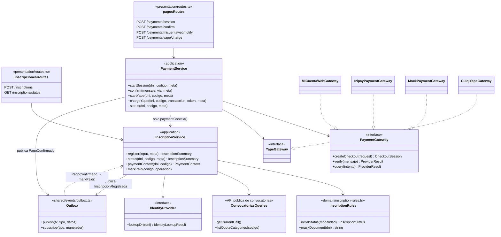
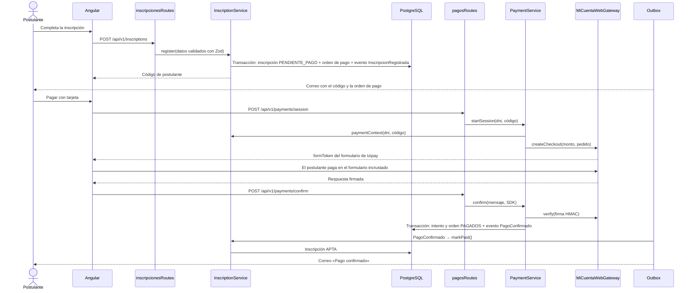

# Nivel 4 · Diagrama de Código

> **Proyecto:** Sistema Integral de Gestión del Proceso de Admisión – UNSCH
> **Módulos detallados:** Inscripción (M03) y Pagos (M05)
> **Modelo:** C4 · Nivel 4 de 4 · **Notación:** UML · **Versión:** 2.0 (02/11/2026), refleja el código implementado

## 1. Objetivo

Mostrar las clases reales de los módulos Inscripción y Pagos y cómo colaboran para **registrar una inscripción y confirmar su pago**. La versión 1.0 de este documento describía un diseño objetivo con una clase por caso de uso y repositorios (`RegistrarInscripcionUseCase`, `InscripcionRepository`, `PaymentPort`); puede consultarse en el historial de Git. La sección 3 resume las diferencias.

| Capa | En el código |
|---|---|
| Presentación | `presentation/routes.ts`: rutas REST con validación Zod |
| Aplicación | `InscriptionService`, `PaymentService` |
| Dominio | `inscription-rules.ts`, `payment-rules.ts`, puertos en `domain/ports.ts` |
| Infraestructura | Adaptadores de pasarela en `pagos/infrastructure/`; bandeja de eventos en `shared/events/outbox.ts` |

## 2. Diagrama de clases

Cada módulo agrupa sus casos de uso en un servicio (capa `application`) y expone su API en `index.ts`. Rutas relativas a `apps/backend/src/modules/`.

## 3. Diferencias con el diseño del sprint 1

| Diseño objetivo | Código real |
|---|---|
| Una clase por caso de uso (`RegistrarInscripcionUseCase`, `ProcesarPagoUseCase`) | Un servicio por módulo (`InscriptionService`, `PaymentService`) con un método por caso de uso |
| `InscripcionRepository` / `PostgresInscripcionRepository`, `PagoRepository` | No existen: los servicios usan Prisma directamente (pendiente) |
| `PaymentPort` y `PaymentGatewayAdapter` | `PaymentGateway` con 3 adaptadores, y `YapeGateway` con `CulqiYapeGateway` |
| `ElegibilidadPort` | La elegibilidad se valida en `InscriptionService` con datos de `ConvocatoriasQueries` |
| `ConfirmarPagoInscripcionUseCase` llamado por Pagos | Pagos publica `PagoConfirmado` y Inscripciones reacciona (Observador), sin llamada directa |
| Entidad `Inscripcion` con estados | Tipo `InscriptionStatus` (generado por Prisma) + reglas en `inscription-rules.ts` |

## 4. Secuencia: registrar inscripción y confirmar pago

Si el navegador se cierra antes de confirmar, el pago se confirma por la notificación IPN (`/payments/micuentaweb/notify`, al tener URL pública) o por la consulta al proveedor (`query`); las tres vías son idempotentes.

## 5. Patrones y principios visibles

| Patrón o principio | Dónde |
|---|---|
| Adaptador | `PaymentGateway` y `YapeGateway` con sus adaptadores |
| Fábrica | `createPaymentGateway` elige micuentaweb, Izipay o la simulada según `PAYMENTS_PROVIDER` |
| Observador | `PagoConfirmado` en la bandeja de eventos; Inscripciones lo escucha |
| Segregación de interfaces | `PaymentService` solo conoce `paymentContext()` de Inscripciones |
| Inversión de dependencias | Cumplida para los servicios externos; pendiente para la base de datos (sin repositorios) |

## 6. Conclusión

El flujo de inscripción y pago respeta las capas de Clean Architecture y desacopla los módulos con eventos. La mejora pendiente es extraer `InscripcionRepository` y `PagoRepository` para que los servicios no dependan de Prisma.
