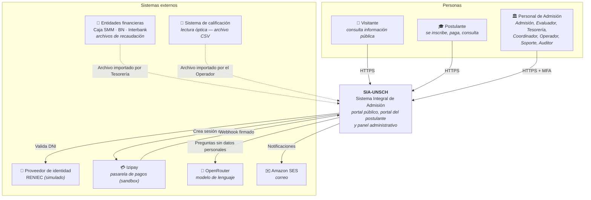
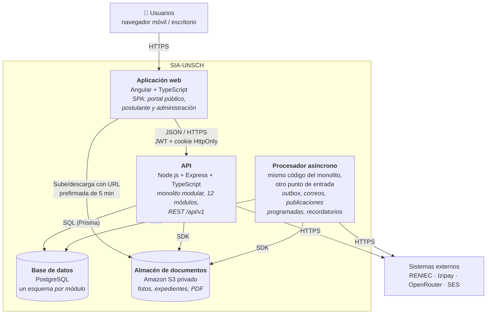
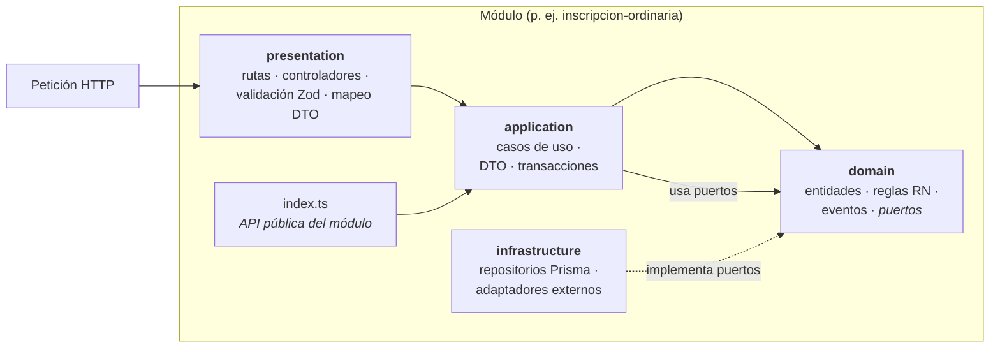
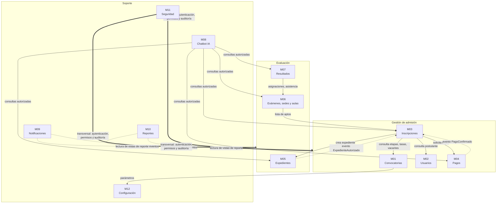
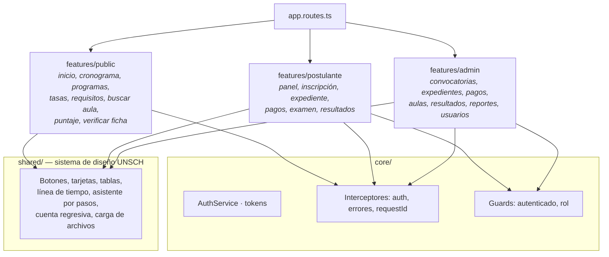
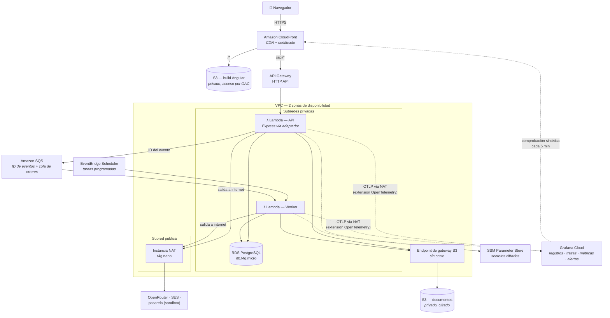
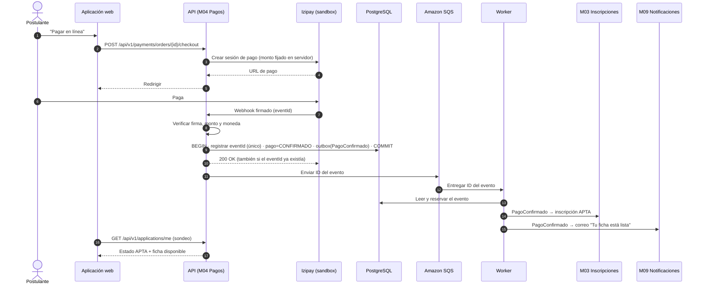

# Arquitectura general — SIA-UNSCH

**Versión:** 1.0 — 25/10/2026 · **Modelo:** C4 (Contexto → Contenedores → Componentes) + vista de despliegue
**Decisiones que la justifican:** [`docs/adr/`](adr/README.md)

> Esta vista es transversal a todas las funcionalidades de `specs/`. Cada `design.md` debe respetarla; si una funcionalidad necesita desviarse, se registra un ADR nuevo.

---

## 1. Impulsores de la arquitectura

Lo que más condiciona el diseño, tomado de la constitución y las especificaciones:

| Impulsor | Fuente | Consecuencia arquitectónica |
|---|---|---|
| Picos de carga muy concentrados (cierre de inscripción, día de resultados) y casi nada el resto del año | RNF-04, RNF-05 | Cómputo que escala por demanda y no cuesta cuando está inactivo → **AWS Lambda** (ADR-009) |
| Reglas de negocio densas y cambiantes por convocatoria | Constitución II.2, `reglas-negocio.md` | **Dominio aislado** y **configuración como datos** (ADR-002, ADR-011) |
| Integridad de pagos, inscripciones y resultados | RNF-09 | Base **relacional transaccional** y **idempotencia** (ADR-005, ADR-008) |
| Integraciones aún no contratadas (RENIEC, pasarela, SMS) | Constitución II.3 | **Puertos y adaptadores**, con simulaciones intercambiables (ADR-007) |
| Datos personales y documentos sensibles | RNF-03, Ley 29733 | Almacenamiento privado, URLs temporales, RBAC y auditoría (ADR-006, ADR-010) |
| Equipo pequeño, plazo de un semestre | Contexto académico | **Un solo backend desplegable**, no microservicios (ADR-001) |
| Publicación a fecha y hora exactas (aulas, resultados) y recordatorios | specs 006, 007, 010 | **Tareas programadas** y procesamiento asíncrono (ADR-012) |

---

## 2. Nivel 1 — Diagrama de contexto

Quién usa el sistema y con qué sistemas externos conversa.

---

## 3. Nivel 2 — Diagrama de contenedores

Las piezas que se despliegan por separado y cómo se comunican.

| Contenedor | Tecnología | Responsabilidad | ADR |
|---|---|---|---|
| Aplicación web | Angular, standalone components, signals, SCSS | Interfaz para los tres públicos, carga diferida por área | ADR-003 |
| API | Node.js 22 + Express + TypeScript + Zod | Casos de uso, reglas, seguridad, contratos REST | ADR-001, ADR-002, ADR-004 |
| Procesador asíncrono | Mismo paquete que la API, otro *handler* | Eventos de la outbox, correos, tareas programadas | ADR-008, ADR-012 |
| Base de datos | PostgreSQL 16 + Prisma | Datos transaccionales, auditoría, outbox | ADR-005 |
| Almacén de documentos | Amazon S3 (privado) | Archivos binarios; la base guarda solo metadatos | ADR-010 |

---

## 4. Nivel 3 — Componentes de la API

### 4.1 Capas dentro de cada módulo (Clean Architecture)

**Regla de dependencias:** las flechas solo apuntan hacia `domain`. El dominio no conoce Express, Prisma ni AWS. Otros módulos solo pueden usar lo que exporta `index.ts` (verificado con reglas de ESLint, ADR-002).

### 4.2 Módulos y sus dependencias

- **Flecha continua** = llamada síncrona a la API pública del otro módulo (`index.ts`).
- **Flecha punteada** = **evento de dominio** publicado en la *outbox* dentro de la misma transacción y entregado después mediante Amazon SQS (ADR-008 y ADR-021). Así, por ejemplo, Pagos no necesita conocer a Inscripción.
- **Reportes (M10)** solo lee **vistas de base de datos** preparadas para reportes; nunca escribe.

### 4.3 Componentes transversales (`apps/backend/src/shared`)

| Componente | Función |
|---|---|
| `http/` | Formato `{ data, meta }` / `{ error }`, `requestId`, manejo central de errores |
| `auth/` | Middleware de autenticación (JWT) y autorización (RBAC + propietario), provisto por M11 |
| `audit/` | Servicio `audit.record()` usado por cualquier módulo en operaciones críticas |
| `events/` | Outbox: `publish()` dentro de la transacción y despachador |
| `clock/` | Reloj inyectable con zona horaria `America/Lima`, para probar etapas y fechas |
| `db/` | Cliente Prisma único y helper de transacciones |
| `config/` | Variables de entorno validadas con Zod al iniciar |

---

## 5. Nivel 3 — Componentes de la aplicación web

Cada área se carga de forma diferida: el visitante del portal público no descarga el código del panel administrativo (RNF-14).

---

## 6. Vista de despliegue en AWS

> **Sin CloudWatch (ADR-013):** el rol de las funciones Lambda no tiene permisos `logs:*`; la observabilidad se hace con OpenTelemetry hacia Grafana Cloud.

| Recurso | Para qué | Nota de costo (verificar en AWS Pricing Calculator) |
|---|---|---|
| CloudFront + S3 (web) | Servir la SPA con HTTPS | Muy bajo con tráfico de demostración |
| API Gateway (HTTP API) + Lambda | API y worker | Se paga por solicitud; casi cero en reposo |
| RDS PostgreSQL `db.t4g.micro`, 20 GB | Base de datos | **Costo fijo mensual** mientras esté encendida (el mayor del sistema) |
| Instancia NAT `t4g.nano` | Salida a internet desde la VPC | Mucho más barata que NAT Gateway administrado (ADR-009) |
| S3 (documentos) | Archivos privados | Bajo |
| SES | Correo; en modo *sandbox* solo envía a direcciones verificadas | Bajo |
| SSM Parameter Store | Secretos (parámetros estándar) | Sin costo |
| Grafana Cloud (externo) | Registros, trazas, métricas, alertas, comprobación sintética | Plan gratuito (verificar límites vigentes) |

**Infraestructura como código:** AWS CDK en TypeScript (`infra/`), con dos entornos: `dev` y `demo`. Un comando despliega y **otro destruye todo** al terminar el curso, para no generar costos (ADR-009).

---

## 7. Flujo crítico de ejemplo: pago confirmado

Cómo colaboran los contenedores y módulos en el flujo más sensible (specs 003 y 005):

---

## 8. Atributos de calidad y tácticas

| Atributo | Escenario (estímulo → respuesta medida) | Tácticas | RNF |
|---|---|---|---|
| Rendimiento | 2 000 consultas de resultados simultáneas → p95 < 3 s | Escalado de Lambda, índices, consultas de solo lectura, caché HTTP en CloudFront para contenido público | RNF-04, RNF-05 |
| Disponibilidad | Falla de una zona de AWS → el servicio continúa | Lambda multi-AZ; RDS con respaldo automático; en `demo`, RDS en una sola AZ (riesgo aceptado, ADR-009) | RNF-06, RNF-12 |
| Observabilidad | Error 500 en producción → el equipo recibe alerta en menos de 5 min con la traza | OpenTelemetry + Grafana Cloud, alertas y comprobación sintética (ADR-013) | RNF-12 |
| Integridad | Webhook repetido 10 veces → un solo pago | Restricción única por `eventId`, transacciones, outbox | RNF-09 |
| Seguridad | Postulante cambia el ID en la URL → 404 | Autorización por propietario en cada caso de uso, IDs no secuenciales (UUID) | RNF-03 |
| Seguridad | Robo de contraseña de personal → sin acceso | MFA TOTP obligatorio para personal | RF-13.06 |
| Auditabilidad | Cambio de vacantes → quién, cuándo, antes y después | `audit_events` solo de inserción; rol de base de datos sin UPDATE ni DELETE en esa tabla | RNF-10 |
| Modificabilidad | Nueva convocatoria 2027-II → sin cambiar código | Configuración como datos y copia de convocatoria | RNF-07 |
| Modificabilidad | Contratar RENIEC real → sin tocar el dominio | Puerto `IdentityProvider` con adaptador nuevo | RNF-07 |
| Privacidad | Pregunta al chatbot con DNI → el proveedor no lo recibe | Enmascarado antes de enviar; herramientas internas autorizadas | RNF-11 |
| Facilidad de prueba | Simular el 08/11 para probar el recargo | Reloj inyectable (`shared/clock`) | — |

---

## 9. Correspondencia funcionalidades → contenedores y módulos

| Funcionalidad | Web | API (módulos) | Worker | Externos |
|---|---|---|---|---|
| 001 Portal público | public | M01, M12 | — | — |
| 002 Cuentas | public, postulante | M02, M11 | correo de verificación | RENIEC (sim.), SES |
| 003 Ordinario | postulante | M03, M04, M05 | ficha, eventos | — |
| 004 Exonerados | postulante, admin | M03, M05 | eventos | — |
| 005 Pagos | postulante, admin | M04 | outbox | Pasarela (sim.) |
| 006 Examen y aulas | public, admin | M06 | publicación programada | — |
| 007 Resultados | public, postulante, admin | M07 | publicación programada | archivo de calificación |
| 008 Panel | admin | M01, M10, M11, M12 | — | — |
| 009 Chatbot | todas | M08 | — | OpenRouter |
| 010 Notificaciones | postulante, admin | M09 | envíos, recordatorios | SES |
