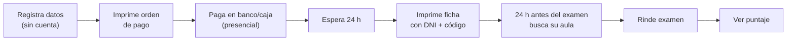
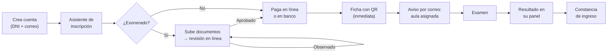

# 01 — Introducción y visión

**Versión:** 1.0 — 25/10/2026 · **Sección IEEE 1016:** Introducción, interesados y preocupaciones de diseño

---

## 1. Propósito

Este documento describe el diseño del **Sistema Integral de Admisión UNSCH (SIA-UNSCH)**, una plataforma web que gestiona de punta a punta el Concurso de Admisión a Pregrado: desde la publicación de la convocatoria hasta la emisión de la constancia de ingreso. Toma como referencia funcional el portal vigente `admision.unsch.edu.pe` (proceso 2027-I) y lo **amplía y mejora**.

Lectores: docente y compañeros del curso de Arquitectura de Software, equipo de desarrollo y, como validadores, personal de la Dirección de Admisión.

## 2. Alcance

### 2.1 Dentro del alcance

| Área | Incluye |
|---|---|
| **Portal público** | Inicio, convocatoria vigente, cronograma interactivo, programas y vacantes, tasas, requisitos, temario, reglamento, comunicados y fe de erratas, pasos de inscripción, buscar aula, consulta de puntaje, denuncias y contacto |
| **Portal del postulante** | Cuenta personal, inscripción ordinaria y exonerados (asistente por pasos), carga de foto y documentos, orden y pago, seguimiento del estado, ficha de inscripción con QR, ficha de examen, resultados y constancia |
| **Panel administrativo** | Convocatorias, vacantes y tasas, revisión de expedientes, conciliación de pagos, aulas y distribución, asistencia, importación y publicación de resultados, reportes, usuarios, roles y auditoría |
| **Servicios** | Chatbot de orientación, notificaciones por correo, verificación pública de fichas por QR |

### 2.2 Fuera del alcance

- Elaboración, impresión y lectura óptica de las pruebas del examen (se **importan** los puntajes).
- Proceso interno del CEPRE-UNSCH (solo se recibe la lista de adjudicados).
- Matrícula posterior al ingreso.
- Integraciones reales con RENIEC y bancos: se entregan **simuladas** salvo autorización institucional.

## 3. Definiciones y siglas

| Término | Definición |
|---|---|
| **Postulante** | Persona que se inscribe en el concurso |
| **Admitido** | Postulante que alcanzó vacante por orden de mérito (Art. 31) |
| **Ingresante** | Admitido que entregó documentos y obtuvo constancia de ingreso (Art. 32, 50) |
| **Modalidad Ordinario** | Examen de conocimientos para primera profesión (Art. 7.2) |
| **Modalidad Exonerados** | Examen para submodalidades especiales del Art. 8 |
| **Submodalidad** | Categoría de exonerado: discapacidad, 1.º/2.º puesto, COAR, deportista, graduado, traslado, víctima, pueblo indígena, CEPRE |
| **Programa de estudios** | Carrera o especialidad a la que se postula (40 opciones en 3 áreas) |
| **Área académica** | I Ciencias, II Letras, III Biomédicas (Art. 3) |
| **Ficha de inscripción** | Documento que acredita la inscripción; se presenta el día del examen |
| **Código de postulante** | Identificador único que aparece en la orden de pago |
| **Extemporáneo** | Inscripción fuera del plazo regular con recargo |
| **Reinscripción** | Exonerado no admitido que se inscribe al examen ordinario (Art. 21) |
| **TUPA** | Texto Único de Procedimientos Administrativos (fuente de tasas) |

## 4. Interesados y preocupaciones de diseño

| Interesado | Preocupación principal | Cómo la atiende el diseño |
|---|---|---|
| Postulante (17–25 años, mayormente desde celular) | Saber qué hacer, cuánto pagar y en qué estado está | Asistente por pasos, simulador de tasa, línea de tiempo de estado, mobile-first |
| Padre/madre de familia | Información clara y confiable | Cronograma con cuenta regresiva, preguntas frecuentes, chatbot |
| Dirección de Admisión | Control del proceso, menos atención presencial | Panel con indicadores, revisión documental en línea, comunicados segmentados |
| Evaluador documental | Revisar expedientes rápido y con trazabilidad | Bandeja de expedientes, observación por documento, historial |
| Tesorería | Cuadrar pagos | Conciliación, estados de pago, exportación |
| Coordinador de examen | Aulas sin sobrecupo, listas de asistencia | Distribución automática con validación de capacidad |
| Comisión de Admisión | Resultados correctos e inmodificables | Importación validada, aprobación antes de publicar, versiones y auditoría |
| Docente del curso | Arquitectura bien justificada | Vistas IEEE 1016, ADR, trazabilidad |

## 5. Actores del sistema

| Actor | Tipo | Responsabilidad |
|---|---|---|
| Visitante | Humano, anónimo | Consulta información pública, busca aula, verifica ficha por QR |
| Postulante | Humano, autenticado | Se inscribe, paga, sube documentos, consulta estado y resultados |
| Administrador general | Humano, interno | Configura el sistema, usuarios y roles |
| Oficina de Admisión | Humano, interno | Convocatorias, vacantes, tasas, comunicados |
| Evaluador documental | Humano, interno | Revisa expedientes de exonerados |
| Tesorería | Humano, interno | Concilia pagos |
| Coordinador de examen | Humano, interno | Sesiones, aulas, asistencia, incidencias |
| Operador de resultados | Humano, interno | Importa, valida y publica resultados |
| Soporte | Humano, interno | Atiende consultas derivadas del chatbot y denuncias |
| Proveedor de identidad (RENIEC) | Sistema externo | Valida DNI (simulado) |
| Pasarela de pagos | Sistema externo | Cobra y notifica por webhook (simulado) |
| OpenRouter | Sistema externo | Modelo de lenguaje del chatbot |
| Servicio de correo | Sistema externo | Envía notificaciones |

---

## 6. Análisis del portal actual (`admision.unsch.edu.pe`)

Inventario realizado sobre 20 capturas del 23/10/2026 (`docs/fuentes/capturas-portal-actual/`).

### 6.1 Funcionalidades existentes

| Sección | Lo que ofrece hoy |
|---|---|
| Cabecera | Escudo, menú *Inicio · Contenido · Pasos · Buscar Aula · Denuncias · Contactos*, botones **Inscripción** y **Reinscripción** |
| Carrusel | 3 diapositivas: "UNSCH Admisión 2027-I", "34 programas de estudios — exonerado 15/11, ordinario 22/11", "Dirección de Admisión" |
| Mensaje del Rector | Texto y foto con botón *Leer más* |
| Importante | Accesos a Tasas, Vacantes y Requisitos |
| Institucional | Pestañas Misión / Principios / Fines |
| Áreas | Tres columnas con los programas: Ciencias (18), Letras (13), Biomédicas (9) |
| Autoridades | Carrusel con mensajes de autoridades |
| Estadísticas | Inscritos: 934 ordinario, 512 exonerados, 1446 total |
| Contactos | Formulario nombre/email/teléfono/mensaje |
| Menú *Contenido* | Imprimir documentos, Reglamento, Programas, Cronograma, Requisitos, Tasa de pagos, Vacantes, Temario, Fe de erratas, Relación de observados, Ver puntaje, Modelo de carta aval |
| Menú *Pasos* | Infografías de pasos Ordinario (4 pasos) y Exonerado (5 pasos) |
| Imprimir documentos | Formulario DNI + código de postulante |
| Reglamento | Visor PDF incrustado |
| Observados | Listas públicas por motivo (inscripción observada, sin pago, fotografía incorrecta) |

### 6.2 Flujo actual del postulante

Para exonerados se añade, **antes de todo**, la presentación presencial de requisitos en Jr. Arequipa N° 175 (4:00–8:00 p.m.).

### 6.3 Problemas detectados

| # | Problema | Evidencia | Impacto |
|---|---|---|---|
| P1 | No hay cuenta del postulante: todo depende de DNI + código | Pantalla *Imprimir documentos* | El postulante no ve su estado; debe volver a ingresar datos en cada consulta |
| P2 | Pago solo presencial y confirmación tras 24 h | Infografía de pasos | Colas, demora, incertidumbre |
| P3 | Exonerados entregan requisitos en físico antes de inscribirse | Pasos exonerado | Viajes y colas; sin trazabilidad de observaciones |
| P4 | **Lista pública con nombres completos** de observados | *Relación de observados* | Exposición de datos personales (Ley 29733) |
| P5 | Contenido desactualizado | Mensaje del Rector menciona Covid-19; ícono de Google+ | Pérdida de credibilidad |
| P6 | Errores de ortografía y datos | "Arqueolgía e Historia: Históría"; filas vacías en Biomédicas | Imagen poco profesional |
| P7 | Inconsistencia de cifras | Carrusel dice 34 programas; la lista muestra 40 opciones; cuadro de vacantes repite código 26 y omite 25 | Confusión |
| P8 | Información en PDF e imágenes | Reglamento, tasas, vacantes, pasos | No buscable, poco accesible, pesado en celular |
| P9 | Sin búsqueda, sin filtros de vacantes, sin calculadora de costo | Toda la web | El postulante calcula a mano su tasa |
| P10 | Sin accesibilidad declarada ni modo móvil optimizado | Capturas en escritorio | Barreras para personas con discapacidad (modalidad propia del concurso) |
| P11 | Formulario de contacto y denuncias sin seguimiento | Sección Contactos | No hay número de caso ni respuesta trazable |
| P12 | Sin notificaciones | — | El postulante debe revisar la web constantemente |

### 6.4 Mejoras propuestas (`MEJ`)

| Código | Mejora | Resuelve | Módulo |
|---|---|---|---|
| MEJ-01 | **Cuenta del postulante** con panel personal | P1 | M02 |
| MEJ-02 | **Línea de tiempo del estado**: registrado → pagado → documentos → apto → aula → resultado → ingresante | P1, P12 | M03, M04 |
| MEJ-03 | **Asistente de inscripción por pasos** con guardado de borrador y validación en vivo (incluida la foto 240×320, fondo blanco) | P1 | M03 |
| MEJ-04 | **Pago en línea** (simulado) con confirmación inmediata por webhook, manteniendo la opción de banco | P2 | M05 |
| MEJ-05 | **Expediente digital** para exonerados: carga de documentos, observaciones por documento y subsanación en línea | P3 | M04, M06 |
| MEJ-06 | **Consulta privada de observaciones** por DNI + código, en lugar de lista pública | P4 | M06 |
| MEJ-07 | **Simulador de tasa**: responde 3 preguntas (modalidad, colegio, condición) y muestra el monto exacto | P9 | M01 |
| MEJ-08 | **Buscador de programas y vacantes** con filtros por área, modalidad y submodalidad | P8, P9 | M01 |
| MEJ-09 | **Cronograma interactivo** con cuenta regresiva y etapa actual resaltada | P8 | M01 |
| MEJ-10 | Contenido en **HTML accesible** (tasas, requisitos, temario) además del PDF descargable | P8, P10 | M01 |
| MEJ-11 | **Ficha con código QR verificable** públicamente (anti-falsificación) | — | M03, M08 |
| MEJ-12 | **Chatbot** de orientación con datos oficiales y consulta de estado autenticada | P9, P12 | M10 |
| MEJ-13 | **Notificaciones por correo** en cada cambio de estado | P12 | M11 |
| MEJ-14 | **Denuncias con número de caso** y seguimiento | P11 | M13 |
| MEJ-15 | **Panel administrativo** con indicadores en tiempo real (inscritos por modalidad/programa, recaudación, ocupación de aulas) | — | M12 |
| MEJ-16 | **Resultados con aprobación previa, versiones y auditoría** | — | M09 |
| MEJ-17 | Gestión de contenido (comunicados, fe de erratas, mensajes de autoridades) sin tocar código | P5 | M14 |
| MEJ-18 | Datos maestros validados (nombres de programas, códigos) | P6, P7 | M01 |

### 6.5 Flujo propuesto

## 7. Referencias

1. Reglamento del Concurso de Admisión a Pregrado 2027-I — `docs/fuentes/REGLAMENTO.pdf`
2. Cronograma 2027-I (Tabla N.° 2) — `docs/fuentes/CRONOGRAMA.pdf`
3. Tasas educativas 2027-I (Tabla N.° 3) — `docs/fuentes/TASAS.pdf`
4. Cuadro de vacantes 2027-I — `docs/fuentes/VACANTES.pdf`
5. Requisitos de inscripción — `docs/fuentes/REQUISITOS.pdf`
6. Temario del examen 2027-I — `docs/fuentes/TEMARIO.pdf`
7. Programas de estudio (perfiles) — `docs/fuentes/programas.pdf`
8. Guía maestra de arquitectura — `docs/fuentes/guia-maestra-arquitectura-implementacion-unsch.md`
9. IEEE Std 1016-2009, *Software Design Descriptions*
10. Ley N.° 29733, Ley de Protección de Datos Personales
