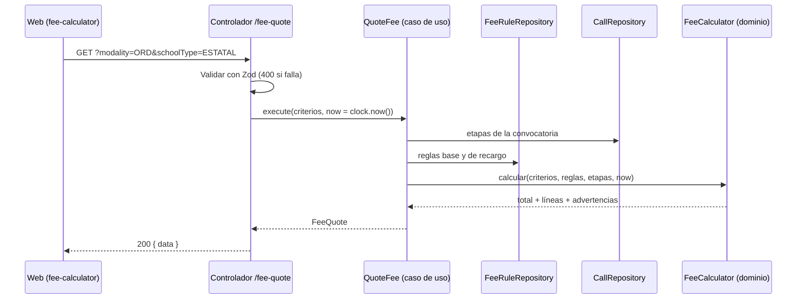
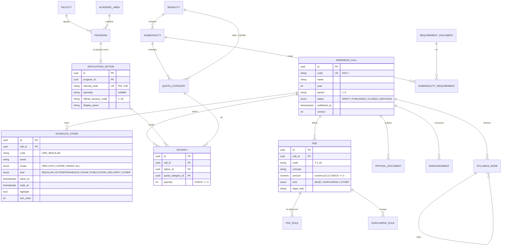

# Diseño — Portal público de admisión

> **SDD (Spec-Driven Development) · artefacto 2 de 3: diseño** (cómo se construye).
> Anterior: [requirements.md](requirements.md) · Siguiente: [tasks.md](tasks.md). Arquitectura general: [docs/arquitectura.md](../../docs/arquitectura.md) y [ADR](../../docs/adr/README.md).


## 1. Plan técnico

**Rama:** `001-portal-publico` · **Fecha:** 25/10/2026 · **Especificación:** [requirements.md](requirements.md)
**Artefactos:** [design.md](design.md) · [design.md](design.md) · [contracts/openapi.yaml](./contracts/openapi.yaml) · [design.md](design.md)

### Resumen

Portal público, accesible y móvil, que reemplaza las secciones informativas de `admision.unsch.edu.pe`: convocatoria vigente con cronograma de estado calculado y cuenta regresiva, buscador de 40 opciones y 1803 vacantes por categoría, simulador de tasas con desglose legal, requisitos/temario/reglamento en HTML, comunicados y contacto con número de caso.

Técnicamente: módulos **M01 Convocatorias** y **M14 Configuración** con endpoints GET cacheables por CloudFront, datos de 2027-I cargados por semilla (ADR-011), y el área `features/public` de Angular. Como primera funcionalidad, **también crea la base del monorepo**: estructura, `shared/` del backend, sistema de diseño, entorno local sin Docker (ADR-014), pipeline y la pila CDK mínima.

### Contexto técnico

| Aspecto | Valor |
|---|---|
| Lenguaje / versión | TypeScript 5.x (`strict`), Node.js 22 LTS |
| Dependencias principales | Angular (estable vigente), Express, Zod, Prisma, pino, OpenTelemetry SDK |
| Almacenamiento | PostgreSQL 16 (esquemas `convocatorias`, `configuracion`, `seguridad`, `shared`) |
| Pruebas | Vitest, PostgreSQL embebido, Supertest, Playwright, axe |
| Plataforma | Navegador (móvil primero) + API REST `/api/v1` |
| Metas | Inicio < 2.5 s en 4G (SC-005); GET públicos p95 < 300 ms sin caché |
| Restricciones | Montos exactos de la Tabla 3 (SC-002); hora de Lima; sin CloudWatch |
| Escala | Picos de miles de visitas en días de cierre; respuestas públicas cacheadas 5 min |

### Verificación de la constitución

| Artículo | ¿Cumple? | Nota |
|---|---|---|
| I — Especificación primero | ✅ | `requirements.md` aprobada; cada escenario tiene su prueba en `design.md` y `tasks.md` |
| II — Fidelidad institucional | ✅ | Datos solo desde la semilla basada en `reglas-negocio.md`; pie "proyecto académico" |
| III — Monolito modular y Clean Architecture | ✅ | M01 y M14 con capas; M01 no lee tablas de M14 |
| IV — Stack aprobado | ✅ | Sin desviaciones |
| V — Seguridad y privacidad | ✅ | Endpoints públicos sin datos personales; contacto con límite de uso; datos del caso visibles solo para Soporte |
| VI — UX móvil y accesible | ✅ | Viewport 360 px y axe en E2E |
| VII — Definición de terminado | ✅ | Ver lista de cierre al final |
| IX — RNF | ✅ | RNF-01, 04, 05, 13, 14 atendidos con caché, prerenderizado y pruebas |

**Re-verificación tras el diseño (Fase 1):** ✅ sin cambios.

### Estructura del proyecto

#### Documentación

```text
specs/001-portal-publico/
├── requirements.md · design.md · design.md · design.md · design.md
├── contracts/openapi.yaml
└── tasks.md            # se genera en /tasks (Paso 5)
```

#### Código fuente

```text
apps/backend/
├── prisma/
│   ├── schema.prisma
│   ├── migrations/
│   └── seed/2027-I/*.json
├── src/
│   ├── shared/{http,auth,audit,events,clock,db,config,telemetry,rate-limit}/
│   ├── modules/
│   │   ├── convocatorias/
│   │   │   ├── domain/        StageStatus, NextMilestone, FeeCalculator, VacancyQuery, ports
│   │   │   ├── application/   GetCurrentCall, SearchOptions, GetOptionDetail, QuoteFee, …
│   │   │   ├── infrastructure/ PrismaCallRepository, PrismaFeeRuleRepository, …
│   │   │   ├── presentation/  calls.routes.ts, schemas.ts
│   │   │   └── index.ts
│   │   ├── configuracion/     announcements, content, feature flags
│   │   └── seguridad/         support cases (solo creación en 001)
│   ├── app.ts · server.ts · lambda-api.ts · lambda-worker.ts
└── tests/{unit,integration,contract}/

apps/frontend/src/app/
├── core/                 interceptores, manejo de errores, reloj
├── shared/ui/            botón, tarjeta, insignia de estado, línea de tiempo, cuenta regresiva,
│                         buscador, tabla responsiva, acordeón, pie académico
└── features/public/
    ├── home/  schedule/  programs/  program-detail/  fee-calculator/
    ├── requirements/  syllabus/  regulation/  announcements/  steps/  contact/

packages/contracts/src/public/*.ts   # esquemas Zod compartidos
infra/lib/{network,data,api,web}-stack.ts
apps/backend/scripts/db.ts            # inicia/detiene PostgreSQL embebido (ADR-014)
```

### Fase 0 — Investigación

Completa en [design.md](design.md): monorepo (R-01), versiones (R-02), hora de Lima y reloj inyectable (R-03), modelo de vacantes (R-04), cálculo de tasas (R-05), contenido en HTML (R-06), rendimiento y caché (R-07), contacto y límites (R-08), estadísticas provisionales (R-09), identidad visual (R-10) y pruebas (R-11).

### Fase 1 — Diseño

- **Modelo de datos:** [design.md](design.md). 25 tablas (17 de M01, 5 de M14, 3 transversales); semilla 2027-I verificable.
- **Contratos:** [contracts/openapi.yaml](./contracts/openapi.yaml). 15 endpoints (14 GET públicos + 1 POST de contacto).
- **Validación:** [design.md](design.md). 18 comprobaciones vinculadas a los escenarios.

#### Diseño del dominio (M01)

| Objeto | Tipo | Responsabilidad | Regla / FR |
|---|---|---|---|
| `StageWindow` | Objeto de valor | Rango de fechas y `statusAt(now)` | FR-002, R-03 |
| `NextMilestone` | Servicio de dominio | Primera etapa destacada futura | FR-003 |
| `Money` | Objeto de valor | Céntimos enteros, suma y formato `S/ 0.00` | R-05 |
| `FeeCalculator` | Servicio de dominio | Elige la regla base más específica, suma el recargo si hay etapa extemporánea en curso para la modalidad y devuelve el desglose y advertencias | FR-006, RN-17 |
| `VacancyMatrix` | Objeto de valor | Totales por opción y categoría; `available(category)` | FR-004 |
| Puertos | Interfaces | `CallRepository`, `FeeRuleRepository`, `VacancyRepository`, `SyllabusRepository`, `EnrollmentStatsProvider` | ADR-002 |

#### Flujo del simulador de tasa



#### Pantallas (área pública)

| Ruta | Pantalla | Historias |
|---|---|---|
| `/` | Inicio: carrusel, etapa actual y cuenta regresiva, accesos rápidos, misión, autoridades, estadísticas | H1, H6 |
| `/cronograma` | Línea de tiempo con estados | H1 |
| `/programas` | Buscador con filtros de área y categoría | H2 |
| `/programas/:codigo` | Ficha de la opción | H2 |
| `/tasas` | Tabla de tasas + simulador | H3 |
| `/requisitos` | Requisitos por submodalidad | H4 |
| `/temario` | Árbol con búsqueda | H4 |
| `/reglamento` | Artículos en HTML + descarga PDF | H4 |
| `/comunicados` | Lista y detalle | H5 |
| `/pasos/ordinario`, `/pasos/exonerado` | Pasos accesibles | FR-009 |
| `/contacto` | Formulario | H6 |

### Bases del repositorio creadas en esta funcionalidad

Como es la primera funcionalidad, `tasks.md` incluirá una fase de preparación con:

1. Monorepo, TypeScript `strict`, ESLint (con reglas de fronteras de ADR-002) y Prettier.
2. Entorno local sin Docker (ADR-014): PostgreSQL 16 embebido, correos y archivos en disco, telemetría opcional.
3. `apps/backend/src/shared/*`: sobre de respuestas y errores, reloj, configuración validada, telemetría con redacción, límite de uso, outbox y auditoría.
4. Sistema de diseño UNSCH en `apps/frontend/src/app/shared/ui` (tokens de color guinda/dorado, tipografía, espaciado, modo de alto contraste).
5. Pipeline de integración continua: lint, pruebas, compilación, validación de OpenAPI.
6. Pila CDK mínima (`Network`, `Data`, `Api`, `Web`) sin desplegar todavía; el primer despliegue a AWS será al cerrar 001 + 002.

### Riesgos

| Riesgo | Mitigación |
|---|---|
| Errores al transcribir los PDF a la semilla | Pruebas de totales contra el cuadro oficial y tabla de casos de la Tabla 3 |
| Caché de CloudFront muestra estados de etapa desfasados hasta 5 min | Aceptable; los estados críticos (inscripción) se revalidan en el servidor al inscribirse (spec 003) |
| Supuesto del recargo sobre tasas especiales (R-05) | Marcado como supuesto; es configuración, se corrige sin código |

### Seguimiento de complejidad

| Desviación de la constitución | Por qué es necesaria | Alternativa más simple descartada porque |
|---|---|---|
| — | — | — |

### Lista de cierre (definición de terminado)

- [ ] Todos los escenarios de `requirements.md` pasan en E2E (móvil y escritorio).
- [ ] Prueba de semilla: 40 opciones, 926 ORD, 1803 en total, 100 % de la Tabla 3.
- [ ] Respuestas conformes a `contracts/openapi.yaml`.
- [ ] axe sin violaciones graves; Lighthouse ≥ 90 en rendimiento y accesibilidad del inicio.
- [ ] `design.md` ejecutado completo por otra persona del equipo.

## 2. Decisiones técnicas (investigación)

**Funcionalidad:** `001-portal-publico` · **Fecha:** 25/10/2026

Al ser la primera funcionalidad, este documento también fija las **bases del repositorio** que usarán todas las demás. Cada entrada tiene: Decisión · Justificación · Alternativas descartadas.

---

### R-01. Organización del repositorio

**Decisión:** monorepo con **npm workspaces**:

```text
apps/frontend   apps/backend   packages/contracts   infra
```

**Justificación:** un solo `npm install`, tipos compartidos en `packages/contracts` (ADR-004) y un pipeline único.
**Alternativas:** Nx o Turborepo (más potentes, curva de aprendizaje innecesaria para 4 paquetes); repositorios separados (duplican configuración y desincronizan contratos).

### R-02. Versiones de herramientas

**Decisión:** Node.js 22 LTS; TypeScript 5.x; Angular en su versión estable vigente al iniciar el Paso 5; Prisma 6.x o superior; PostgreSQL 16. **Las versiones exactas se fijan en `package.json` (sin `^`) el día en que se crea el repositorio**, y se registran en el `design.md`.
**Justificación:** compatibilidad con el runtime `nodejs22.x` de Lambda y reproducibilidad.
**Alternativas:** rangos flotantes (rompen compilaciones de forma impredecible).

### R-03. Hora oficial y cálculo del estado de las etapas

**Decisión:**
- Las fechas se guardan como `timestamptz` en UTC.
- Las fechas oficiales se cargan interpretadas en **America/Lima** (UTC−5, sin horario de verano): una etapa "del 07/09 al 06/11" va de `2026-09-07 00:00:00-05` a `2026-11-06 23:59:59.999-05`.
- El estado se **calcula** en el dominio, no se guarda:

```text
Próxima     si ahora <  inicio
En curso    si inicio ≤ ahora ≤ fin
Finalizada  si ahora >  fin
```

- El **siguiente hito** es la primera etapa con `highlight = true` (exámenes, publicaciones) cuyo inicio es posterior a ahora.
- El reloj es inyectable (`shared/clock`). En `dev` y `test`, la variable `APP_FIXED_NOW` fija la hora para probar escenarios (p. ej. `2026-11-08T10:00:00-05:00`); está **prohibida** en `demo` (la validación de configuración falla al iniciar).

**Justificación:** caso límite "cambio de día a medianoche en hora de Perú" (spec 001) y ADR-012 (las etapas no dependen de tareas programadas).
**Alternativas:** guardar el estado en una columna actualizada por un cron (puede desfasarse); fechas sin zona horaria (errores al ejecutar en servidores UTC).

### R-04. Modelo de vacantes: opciones y categorías

**Decisión:** la tabla oficial de 40 filas × 16 columnas se modela como:
- **Opción de postulación** (`P01`–`P40`): un programa o una especialidad (aclaración del 25/10/2026).
- **Categoría de vacante** (16): `ORD`, `DIS`, `PS-U`, `PS-R`, `DEP`, `CE-I`, `CE-II`, `GRA`, `TI`, `TEN`, `TEI`, `VI-U`, `VI-R`, `AND`, `AMZ`, `COAR`. Cada una apunta a su modalidad/submodalidad y variante.
- **Vacante**: (convocatoria, opción, categoría) → cantidad. 640 filas para 2027-I.

**Justificación:** el filtro "por submodalidad" de la Historia 2 es una consulta directa; los totales se obtienen sumando y se verifican contra el cuadro oficial (SC-003).
**Alternativas:** 16 columnas en una tabla ancha (cada nueva submodalidad obliga a migrar el esquema).

### R-05. Cálculo de tasas (simulador)

**Decisión:** reglas como datos (ADR-011):
- `fee_rules`: criterios (modalidad, submodalidad, gestión del colegio, condición militar, vínculo familiar) → concepto de la Tabla 3. Se elige la regla **más específica** (mayor `priority`).
- `surcharge_rules`: recargo según el tipo de etapa en curso para esa modalidad (`EXTEMPORANEOUS`), con regla particular para CEPRE (S/ 50.00) y general (S/ 65.00).
- El dominio calcula: `monto = base + recargo` y devuelve el **desglose** con la cita legal de cada parte.
- Montos con `numeric(10,2)` en la base y aritmética en céntimos enteros en TypeScript (sin `float`).

**Supuesto a validar con Admisión:** el recargo extemporáneo se suma también a las tasas especiales (vínculo familiar S/ 30, víctimas S/ 30), porque la Tabla 3 ítem 4 no hace excepciones.
**Justificación:** SC-002 exige coincidencia del 100 % con la Tabla 3; las reglas como datos permiten probar todas las combinaciones con una tabla de casos.
**Alternativas:** `switch` en el código (cada convocatoria exige programar); motor de reglas genérico (sobrediseño, ADR-011).

### R-06. Contenido oficial en HTML (requisitos, temario, reglamento)

**Decisión:**
- **Requisitos**: datos estructurados (`requirement_documents` + relación con submodalidad) → se reutilizan en el expediente de la spec 004.
- **Temario**: árbol `syllabus_nodes` (área → curso → sección → tema) cargado desde un JSON semilla transcrito del PDF; búsqueda con `ILIKE` sobre una columna normalizada sin tildes (`unaccent`).
- **Reglamento**: Markdown por capítulo y artículo, guardado como contenido; el PDF oficial se sirve como descarga.
- Los PDF oficiales se suben al bucket de documentos públicos de la web (no al de documentos personales).

**Justificación:** MEJ-10 y RNF-13 (accesibilidad), y reutilización de los requisitos.
**Alternativas:** incrustar el PDF (lo que hace el portal actual: no es accesible ni se lee bien en celular); búsqueda de texto completo con `tsvector` (innecesaria para menos de 1 000 temas).

### R-07. Rendimiento del portal público

**Decisión:**
- Las respuestas GET públicas llevan `Cache-Control: public, max-age=300` y CloudFront las cachea; las estadísticas, `max-age=3600` (Historia 6: "al menos cada hora").
- Angular **prerenderiza** las páginas cuyo contenido no cambia en la convocatoria (pasos, institucional) y carga los datos dinámicos por API.
- Imágenes en WebP/AVIF con `srcset`; la imagen del carrusel se carga primero y el resto en diferido.

**Justificación:** SC-005 (inicio < 2.5 s en 4G) y RNF-04 (picos) sin agregar Redis.
**Alternativas:** renderizado en servidor en Lambda (más arranques en frío y complejidad); Redis (costo fijo, ADR-009).

### R-08. Formulario de contacto y protección contra abuso

**Decisión:**
- Límite de **5 mensajes por hora** por IP (guardada como hash con sal), con contador en PostgreSQL (`rate_limit_counters`, ventana fija). El mismo mecanismo se reutiliza en la spec 002.
- Campo trampa oculto (*honeypot*): si llega con contenido, se responde 202 sin guardar.
- El mensaje crea un **caso de atención** en el módulo M13 con número `C-2027I-000123` y se envía una copia por correo (vía outbox, ADR-008).

**Justificación:** escenario 6.3 de la spec y ausencia de Redis.
**Alternativas:** CAPTCHA de un tercero (fricción y dependencia; se puede agregar después si hay abuso real); throttling de API Gateway (es global, no por usuario).

### R-09. Estadísticas de inscritos antes de que exista la spec 003

**Decisión:** el portal consulta un puerto `EnrollmentStatsProvider`. Hasta implementar la spec 003, su adaptador devuelve **0** en cada modalidad con la marca `source: "pending"`, y la interfaz oculta la sección si todos son 0.
**Justificación:** permite entregar 001 sin depender de 003 (Historia 6 es P3).
**Alternativas:** mostrar las cifras del portal actual (serían datos ajenos presentados como propios).

### R-10. Imágenes institucionales y escudo

**Decisión:** se usan el escudo y las fotos aportadas en `docs/fuentes/capturas-portal-actual/` **solo en los entornos `dev` y `demo` del curso**, con el pie "Proyecto académico — no es el portal oficial" en todas las páginas (Constitución II.4).
**Justificación:** identidad visual requerida (Constitución VI.3) sin aparentar ser el sitio oficial.

### R-11. Pruebas

**Decisión:**
| Nivel | Herramienta | Qué cubre en 001 |
|---|---|---|
| Unitarias | Vitest | Estado de etapas, siguiente hito, calculadora de tasas (tabla con todas las combinaciones de la Tabla 3), filtros de vacantes |
| Integración | Vitest + PostgreSQL embebido efímero (ADR-014) | Semilla 2027-I: 40 opciones, 926 ORD, 1803 en total; consultas de búsqueda |
| Contrato | Supertest + validación contra `contracts/openapi.yaml` | Cada endpoint responde según el contrato |
| E2E | Playwright (viewport 360 × 800 y escritorio) | Escenarios de aceptación de las Historias 1–3 |
| Accesibilidad | `@axe-core/playwright` | 0 violaciones graves en las páginas públicas |

**Justificación:** Constitución I.3 (cada escenario se convierte en prueba) y VII.

## 3. Modelo de datos

**Funcionalidad:** `001-portal-publico` · **Fecha:** 25/10/2026
**Esquemas de PostgreSQL:** `convocatorias` (M01), `configuracion` (M14), `seguridad` (M13, solo casos de atención), `shared` (límites de uso)
**Convenciones (ADR-005):** PK `id uuid`, `created_at`, `updated_at timestamptz`; `version int` en entidades editables; nombres en inglés.

---

### 1. Diagrama entidad-relación



---

### 2. Entidades del módulo M01 — Convocatorias (`convocatorias`)

#### `admission_calls`
| Columna | Tipo | Reglas |
|---|---|---|
| `code` | `varchar(10)` | Único. Formato `AAAA-I` o `AAAA-II` |
| `status` | enum | `DRAFT → PUBLISHED → CLOSED → ARCHIVED`. El portal solo muestra `PUBLISHED` y `CLOSED` |
| `published_at` | `timestamptz` | Obligatorio si `status ≠ DRAFT` |

**Convocatoria vigente:** la `PUBLISHED` más reciente; si no hay, la respuesta indica "Próximamente" (escenario 1.4).

#### `schedule_stages`
| Columna | Tipo | Reglas |
|---|---|---|
| `code` | `varchar(40)` | Único por convocatoria |
| `scope` | enum | A qué modalidad aplica la etapa |
| `kind` | enum | `EXTEMPORANEOUS` activa los recargos (R-05) |
| `starts_at`, `ends_at` | `timestamptz` | `CHECK (ends_at >= starts_at)` |
| `highlight` | `bool` | Candidata a "siguiente hito" (exámenes, publicaciones) |

**Estado calculado** (no se guarda): `UPCOMING | IN_PROGRESS | FINISHED` (research R-03).

#### `academic_areas`, `faculties`, `programs`, `application_options`
| Entidad | Campos clave | Reglas |
|---|---|---|
| `academic_areas` | `code` (`I`, `II`, `III`), `name` | 3 filas fijas |
| `faculties` | `name`, `dean_name` | — |
| `programs` | `name`, `faculty_id`, `area_id`, `schedule_number` (1–34) | 34 programas; `schedule_number` resuelve DQ-2 |
| `application_options` | `internal_code` (`P01`–`P40`, único), `specialty`, `official_vacancy_code`, `display_name`, `duration_years`, `degree`, `professional_title`, `profile_page` | 40 opciones; `display_name` = "Biología: Microbiología". Duración, grado y título van en la opción porque varían por especialidad (p. ej. Educación Secundaria). El perfil de ingreso se enlaza a su página en el PDF oficial (`profile_page`) en lugar de transcribirlo |

#### `modalities`, `submodalities`, `quota_categories`
| Entidad | Ejemplos | Reglas |
|---|---|---|
| `modalities` | `ORD`, `EXO`, `CEPRE` | — |
| `submodalities` | `EXO-DIS`, `EXO-PSP`, `EXO-COAR`, `EXO-DEP`, `EXO-GRA`, `EXO-TRI`, `EXO-TEN`, `EXO-TEI`, `EXO-VIC`, `EXO-PIN` | `legal_basis`, `uses_base_documents bool` |
| `quota_categories` | `ORD`, `DIS`, `PS-U`, `PS-R`, `DEP`, `CE-I`, `CE-II`, `GRA`, `TI`, `TEN`, `TEI`, `VI-U`, `VI-R`, `AND`, `AMZ`, `COAR` | `modality_id`, `submodality_id` nulo para `ORD`/`CE-*`, `variant` (`URBANO`, `RURAL`, `ANDINO`, `AMAZONICO`, `CICLO_I`, `CICLO_II`), `sort_order` |

#### `vacancies`
- Única por `(call_id, option_id, quota_category_id)`.
- 2027-I: 40 × 16 = **640 filas**; Σ `ORD` = 926; Σ total = **1803**.
- Bloqueo: si la convocatoria está `PUBLISHED`, no se permite `UPDATE` salvo con resolución (spec 008, RN-03); en 001 solo se lee.

#### `fees`, `fee_rules`, `surcharge_rules`

**`fees`** — los 24 conceptos de la Tabla 3 (`T-1.1E` … `T-7`).

**`fee_rules`** — cómo se elige la tasa base:

| Columna | Tipo | Ejemplo |
|---|---|---|
| `fee_id` | FK | `T-1.3P` |
| `modality_code` | `varchar` | `ORD` |
| `submodality_code` | `varchar` nulo | `EXO-GRA` |
| `school_type` | enum nulo | `ESTATAL`, `PARTICULAR` |
| `military_condition` | enum nulo | `NONE`, `ACTIVE`, `DISCHARGED` |
| `family_link` | `bool` nulo | `true` solo para `T-3` |
| `priority` | `int` | La regla coincidente con mayor prioridad gana |

Un criterio nulo significa "cualquiera". Ejemplo: `T-3` tiene `family_link = true` y la prioridad más alta.

**`surcharge_rules`** — recargo por etapa:

| `fee_id` | `applies_to_scope` | `stage_kind` | `priority` |
|---|---|---|---|
| `T-4` (65.00) | `ORD`, `EXO` | `EXTEMPORANEOUS` | 10 |
| `T-CEPRE-EXT` (50.00) | `CEPRE` | `EXTEMPORANEOUS` | 20 |

#### `requirement_documents`, `submodality_requirements`
| Entidad | Campos clave |
|---|---|
| `requirement_documents` | `code`, `name`, `description`, `article`, `accepted_formats`, `is_base` (los 4 del Art. 36) |
| `submodality_requirements` | `submodality_id`, `requirement_id`, `mandatory`, `sort_order` |

Requisitos de una submodalidad = (base, si `uses_base_documents`) ∪ (los propios). Reutilizado por la spec 004.

#### `syllabus_nodes`
`id`, `call_id`, `parent_id` (nulo en la raíz), `level` (`AREA | COURSE | SECTION | TOPIC`), `title`, `title_search` (sin tildes, en minúsculas), `sort_order`.

#### `official_documents`
`call_id`, `type` (`REGLAMENTO | CRONOGRAMA | TASAS | VACANTES | REQUISITOS | TEMARIO | PROGRAMAS | OTRO`), `title`, `public_url`, `published_at`, `size_bytes`.

---

### 3. Entidades del módulo M14 — Contenido (`configuracion`)

| Entidad | Campos clave | Reglas |
|---|---|---|
| `announcements` | `call_id`, `type` (`COMUNICADO | FE_ERRATAS | RESULTADO`), `title`, `body_md`, `affects_section` (`TASAS`, `VACANTES`, …, nulo), `published_at` | Visibles si `published_at ≤ ahora`, ordenados descendentemente |
| `content_blocks` | `key` (`mission`, `principles`, `purposes`, `steps_ord`, `steps_exo`), `body_md` | Uno por clave |
| `hero_slides` | `title`, `subtitle`, `image_url`, `cta_label`, `cta_route`, `sort_order`, `active` | Carrusel del inicio |
| `authority_messages` | `name`, `position`, `message`, `photo_url`, `sort_order` | Carrusel de autoridades |
| `feature_flags` | `key` (`INSCRIPCION`, `REINSCRIPCION`, `BUSCAR_AULA`, `VER_PUNTAJE`, `IMPRIMIR_DOCUMENTOS`), `enabled`, `linked_stage_code` | Acceso visible solo si `enabled` y la etapa vinculada está en curso (FR-013) |

---

### 4. Entidades transversales

#### `seguridad.support_cases` (casos de atención, creados desde el contacto)
| Columna | Tipo | Reglas |
|---|---|---|
| `case_number` | `varchar(20)` | Único, formato `C-2027I-000123` (secuencia por convocatoria) |
| `type` | enum | `CONTACT` en 001; `COMPLAINT` y `CHATBOT_ESCALATION` en specs 008 y 009 |
| `name`, `email`, `phone` | texto | Datos personales; visibles solo para Soporte |
| `message` | texto | Máximo 2 000 caracteres |
| `status` | enum | `OPEN → IN_PROGRESS → CLOSED` |

#### `shared.rate_limit_counters`
`key` (p. ej. `contact:<hash-ip>`), `window_start`, `count`. Clave primaria `(key, window_start)`; se borran ventanas de más de 1 día (tarea diaria del worker).

#### `shared.outbox` (definida aquí, usada por todas las funcionalidades — ADR-008)
`id`, `event_type`, `payload jsonb`, `occurred_at`, `correlation_id`, `processed_at` nulo, `attempts`, `last_error`.
En 001 se publica `CasoContactoCreado` → correo de copia al remitente.

---

### 5. Semilla 2027-I (`apps/backend/prisma/seed/2027-I/`)

| Archivo | Contenido | Verificación automática |
|---|---|---|
| `call.json` | Convocatoria 2027-I `PUBLISHED` | — |
| `stages.json` | 13 etapas del cronograma (Tabla 2, ver `reglas-negocio.md` §4) en hora de Lima | Ninguna con fin antes del inicio |
| `programs.json` | 34 programas, 40 opciones `P01`–`P40`, área, facultad | 18 / 13 / 9 opciones por área |
| `quota-categories.json` | 16 categorías | — |
| `vacancies.json` | 640 cantidades | Σ ORD = 926, Σ total = 1803, Σ por columna = cuadro oficial |
| `fees.json` | 24 conceptos + reglas + recargos | Tabla de casos de la Tabla 3 = 100 % |
| `requirements.json` | Documentos del Art. 36–49 por submodalidad | Cada submodalidad tiene al menos 1 documento |
| `syllabus.json` | Temario: 5 áreas, 18 cursos, temas | — |
| `content.json` | Misión, pasos, carrusel, autoridades | — |

**Fuente única:** `docs/reglas-negocio.md`. Si cambia, se actualiza la semilla y la prueba de integración lo detecta.

## 4. Guía de validación

**Funcionalidad:** `001-portal-publico`
**Objetivo:** comprobar de punta a punta que la implementación cumple `requirements.md`. Cada paso indica el escenario que valida.

> Los comandos se ejecutan desde la raíz del repositorio en PowerShell. Se completan en el Paso 5, cuando exista el código.

### 1. Preparación (una sola vez)

Solo se necesita Node.js (sin Docker, ADR-014).

```powershell
npm.cmd install                   # incluye PostgreSQL 16 embebido
npm.cmd run db:setup              # inicia PostgreSQL, aplica migraciones y carga la semilla 2027-I
```

### 2. Levantar con una fecha simulada

```powershell
$env:APP_FIXED_NOW = "2026-10-25T10:00:00-05:00"
npm.cmd run dev                   # API en http://127.0.0.1:3000 · web en http://127.0.0.1:4200
```

### 3. Validaciones

| # | Acción | Resultado esperado | Valida |
|---|---|---|---|
| 1 | Abrir `http://127.0.0.1:4200` | "Admisión 2027-I"; etapa *Inscripción regular — Ordinario* en curso hasta el 06/11; cuenta regresiva al examen de Exonerados del 15/11 | H1-E1 |
| 2 | Reiniciar con `APP_FIXED_NOW=2026-11-08T10:00:00-05:00` y abrir *Cronograma* | Regular ordinaria "Finalizada"; extemporánea "En curso" con aviso de recargo S/ 65.00 | H1-E2, H1-E3 |
| 3 | Vaciar la convocatoria (`npm.cmd run db:seed -- --empty`) y abrir el inicio | Aviso "Próximamente" | H1-E4 |
| 4 | En *Programas*, escribir "sistemas" | Ingeniería de Sistemas · Área I · 20 ORD · 50 en total | H2-E1 |
| 5 | Filtrar Área III | 9 opciones | H2-E2 |
| 6 | Elegir la categoría "Graduados y/o titulados" | Arquitectura, Ing. Ambiental, Psicología, Ing. Geológica, Biotecnología, Ecología, Ed. Sec. Matemática y Ed. Sec. CC.SS. aparecen "Sin vacantes en esta modalidad" | H2-E3 |
| 7 | Abrir la ficha de Ingeniería Agrícola | Facultad de Ciencias Agrarias, 5 años, grado y título, perfil de ingreso, vacantes por modalidad | H2-E4 |
| 8 | Simulador: Ordinario + estatal (fecha 25/10) | S/ 250.00 | H3-E1 |
| 9 | Simulador: Ordinario + particular + licenciado | S/ 225.00 con nota "25 % de descuento — Art. 61, Ley 29248" | H3-E2 |
| 10 | Simulador: Ordinario + estatal con fecha 08/11 | S/ 250.00 + S/ 65.00 = S/ 315.00 | H3-E3 |
| 11 | Simulador: Exonerados → Graduados | S/ 485.00 | H3-E4 |
| 12 | Simulador: vínculo familiar UNSCH | S/ 30.00 y advertencia de beneficio por única vez | H3-E5 |
| 13 | *Requisitos* → Deportista calificado | 4 documentos base + 3 del Art. 40 | H4-E1 |
| 14 | *Temario* → buscar "trigonometria" (sin tilde) | Lleva a Área II Matemática → Trigonometría | H4-E2 |
| 15 | Publicar una fe de erratas de tasas (semilla de prueba) y abrir *Tasas* | Aviso destacado enlazado | H5-E1 |
| 16 | Enviar el formulario de contacto | Número `C-2027I-000001`; correo de copia guardado en `apps/backend/.dev-mail/` | H6-E2 |
| 17 | Enviar 6 mensajes seguidos | El sexto devuelve 429 con mensaje amable | H6-E3 |
| 18 | Abrir el inicio con un viewport de 360 px (DevTools) | Sin desplazamiento horizontal | SC-004 |

### 4. Pruebas automáticas

```powershell
npm.cmd run test -w apps/backend           # unitarias + integración (semilla: 926 / 1803)
npm.cmd run test:contract -w apps/backend  # contra contracts/openapi.yaml
npm.cmd run e2e -w apps/frontend           # Playwright: H1–H3, móvil y escritorio, axe
```

### 5. Comprobación de la API sin interfaz

```powershell
curl.exe "http://127.0.0.1:3000/api/v1/calls/2027-I/fee-quote?modality=ORD&schoolType=ESTATAL&at=2026-11-08T10:00:00-05:00"
# total = "315.00"
```

### 6. Observabilidad local

En la consola de la API, cada solicitud aparece con su `requestId`, y ningún registro contiene correos ni nombres del formulario de contacto (ADR-013). Con `OTEL_EXPORTER_OTLP_ENDPOINT` definido, lo mismo se ve en Grafana Cloud.

## 5. Contratos de la API

- [contracts/openapi.yaml](contracts/openapi.yaml)

## 6. Actualizaciones de diseño (27 y 28/10/2026)

- **Cabecera como el portal oficial:** Inicio, Contenido (menú amplio de tres columnas con el escudo «Real, Pontificia y Nacional 1677»), Pasos, Buscar Aula, Denuncias y Contactos; botones Inscripción (verde) y Reinscripción (celeste). `apps/frontend/src/app/shared/site-header.ts`.
- **Denuncias** (`/denuncias`): formulario reservado (nombre opcional) que crea un caso tipo `COMPLAINT` en el panel (`POST /support/complaint`); tarjetas de la Contraloría, correo y horario de la Comisión.
- **Contactos** (`/contacto`): equipo de la Dirección de Admisión, canales, Mesa de Partes Virtual (`tramite.unsch.edu.pe`), horario de atención y consulta con número de caso.
- **Relación de observados** (`/observados`, `GET /inscriptions/observed`): solo código de postulante y modalidad, sin datos personales. **Modelo de carta aval** (`/carta-aval`, Art. 49) imprimible.
- **Imágenes de la portada editables** desde el panel (RF-14.01, entidad `SiteAsset`, `GET /site-assets`); la foto del ingreso de la Ciudad Universitaria es de Wikimedia Commons (CC BY-SA 4.0, con crédito).
- El rediseño con las skills de diseño (26/10) se **revirtió** a pedido: el portal conserva su diseño original (Archivo, guinda y dorado).

### Pulido de interfaz (29/10/2026)

- **Celular y botones oficiales** (crítica de Impeccable del 29/10/2026): bajo 1280 px, Inscripción (verde) y Reinscripción (celeste) quedan visibles y compactos junto a «Menú» (`site-header.ts`); en la portada del celular el texto con «Inscribirme» va primero y la fachada debajo (`home.scss`); el asistente es más pequeño y en la inscripción se ubica encima de la barra fija (`assistant.ts`, `styles.scss`).
- **Accesibilidad (segunda ronda):** anillo de foco de dos tonos en todo el portal (línea interior en tinta, visible sobre fondos claros; exterior dorada, visible sobre guinda); cada mensaje de error lleva un ícono dibujado y se anuncia como «Error:»; `scroll-padding` para que lo enfocado no quede bajo la cabecera fija (`styles.scss`).
- **Denuncias y Contactos:** etiquetas visibles en todos los campos, textos de ejemplo con contraste 5,1:1 (antes 3,3:1), promesa honesta sobre la reserva («el nombre es opcional; el correo solo se usa para responder») y horario de la Comisión rotulado como atención de denuncias. Se conserva el aspecto del portal oficial.
- **Trámites a la vista** (segunda crítica, 28/40): el menú «Contenido» se ordena en tres columnas con título: **Mis trámites** (Mi inscripción: pagar e imprimir, Buscar mi aula, Ver puntaje, Relación de observados, Mi cuenta), **Antes de postular** y **Publicaciones**; la cabecera sigue igual a la del portal oficial. «Imprimir documentos» pasa a llamarse **«Mi inscripción»** en toda la web. En la portada, el botón principal es el trámite de la etapa en curso (Inscribirme → Buscar mi aula → Ver mi puntaje, según los accesos que habilita el backend) y ese trámite ya no se repite en los accesos rápidos; cada acceso lleva a su propia página (antes Buscar aula y Ver puntaje llevaban a «Imprimir documentos»).
- **Botón principal único y asistente discreto** (segunda crítica, P2): `.btn--gold` y su estado al pasar el puntero (`--gold-hover`) viven una sola vez en `styles.scss`, con la regla escrita: guinda sobre fondo claro (`.btn`), dorado sobre campo guinda (`.btn--gold`), blanco solo en la portada (`.btn--light`); se quitaron las 6 copias locales. En pantallas de hasta 1100 px, mientras hay un campo de formulario enfocado, el lanzador del asistente se aparta hacia abajo y vuelve al salir del campo, para no tapar opciones como «Carné de extranjería».
- **Tercera crítica (28/40), los 4 P1:** (1) **Contactos y Denuncias sin desborde en el celular**: pistas `minmax(0, 1fr)` y correos que se parten (`overflow-wrap: anywhere`); a 375 px la página mide 375 px. (2) **Denuncias** conserva el aspecto del portal oficial, pero usa el foco de dos tonos del portal (se quitó `outline: none`), marca con * y `aria-required` el correo y los hechos, tutea como el resto del sitio y quita la sombra del botón; los «×» de cerrar aviso miden 44 × 44 px (también en Contactos). (3) **Portada con estado de carga**: «Cargando los programas de estudio…» y «Cargando comunicados…» en lugar de «0 Ciencias» y «No hay comunicados» mientras llega la respuesta (unos 5 s desde RDS), y un mensaje si la carga falla.
- **Tercera crítica, P2 (imágenes y asistente):** las imágenes del sitio tienen variantes WebP generadas con `node scripts/optimizar-imagenes.mjs` (sharp, dependencia de desarrollo) y se sirven con `srcset`/`sizes`: fachada 206 KB → 25 KB (640 px) o 65 KB (1280 px); Ciudad Universitaria 616 KB → 36/142 KB; infografías de pasos ~390 KB → 36–96 KB; rector 152 KB → 11/25 KB; escudo de la cabecera 70 KB → 7 KB (112 px). `SiteImages.srcset()` devuelve `null` cuando la imagen fue reemplazada desde el panel (RF-14.01), para que el reemplazo no quede tapado por las variantes originales. El globo «¿Te ayudo con tu admisión?» se muestra 8 s en la primera página de la visita y luego solo al pasar el puntero o enfocar el botón, para no tapar el cronograma.
- **Cuarta crítica, P2 (datos y fechas):** la portada aclara que son **34 programas y 40 opciones** (algunos se eligen por especialidad) y cada área dice «N opciones». «Buscar aula» y «Ver puntaje» muestran arriba, antes de pedir datos, las fechas de publicación de cada examen calculadas del cronograma (aulas 24 h antes: 14 y 21 de noviembre; resultados el día del examen: 15 y 22), con la marca «publicado» o «examen rendido» cuando corresponde.
- **Cuarta crítica, P3 (Contactos, Denuncias y textos):** Contactos tutea como el resto del sitio («Envíanos tu consulta», aviso y errores), enlaza el portal web y marca con * y `aria-required` nombre, correo y consulta. En Contactos y Denuncias el borde de los campos pasa de #d6d6d6 a #858585 (contraste 3,6:1 sobre #fafafa, WCAG 1.4.11). En Denuncias, «Ir a Contraloría» lleva tilde y la nota de reserva se liga con `aria-describedby` al nombre y al correo. En «Mi inscripción» el botón dice «Ver mi inscripción» (antes «Buscar documentos»); los scripts e2e se actualizaron. Pendiente del cliente: el teléfono y la dirección de Facebook oficiales de la Dirección de Admisión (no se inventan).
- **Quinta crítica (29/40), contraste y foco:** los campos `.input`/`.select` de todo el sitio conservan el anillo global de dos tonos al enfocarse (se quitó `outline: none`), así que en Mi inscripción, Buscar aula y Resultados el foco ya no queda en un anillo oscuro de 1,4:1 sobre guinda; esos campos también pasan su borde a dorado. El borde por defecto usa el nuevo token `--field-line` (#857a72, unos 4,3:1 sobre blanco) en lugar del color de relleno (1,14:1), que afectaba al buscador de la portada.
- **Misión y principios en la portada** (29/10/2026, a pedido del cliente): la foto ancha del ingreso (Wikimedia) se reemplaza por una sección guinda con la **Misión** y los **7 principios** de la UNSCH, citados literalmente del Plan Estratégico Institucional publicado en appweb.unsch.edu.pe/informacion-institucional (no se encontró una visión oficial publicada, por eso no se muestra), y una galería de **7 fotos de la Ciudad Universitaria** entregadas por el cliente (`public/img/campus/`). Las fotos se muestran a su tamaño original o menor (180 × 152 px en escritorio; mosaico de 3 columnas en el celular) para que se vean nítidas; se quitó el espacio «portada.campus» del panel de imágenes.
- **Infografías de pasos actualizadas** (29/10/2026): las infografías oficiales de Ordinario y Exonerado se reemplazan por las versiones completas que entregó el cliente (1042 × 822 px, sin recortes), con variantes WebP de 640 y 1040 px (no se amplían por encima del original) en la portada y en «Pasos».
- **Acabado formal** (29/10/2026, skill frontend-design, sin rediseñar): tokens `--radius` (6 px, botones y campos) y `--radius-lg` (10 px, paneles y avisos); botones semibold de 3 rem con borde del mismo tono y secundario de contorno fino; campos con fondo blanco y borde de 1 px; enlaces de acción subrayados sin flecha «→»; sin animaciones de entrada en cada sección; títulos del menú «Contenido» y etiquetas de datos sin mayúsculas forzadas; principios con viñeta (no son una secuencia); fotos sin zoom al pasar el puntero; barra del celular «Paso 1 de 6: Tus datos». Colores, estructura y cabecera oficial sin cambios.
