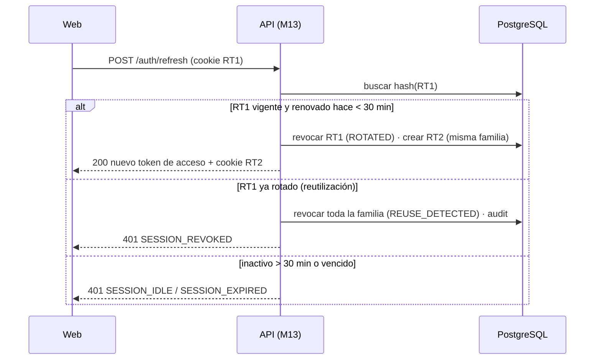
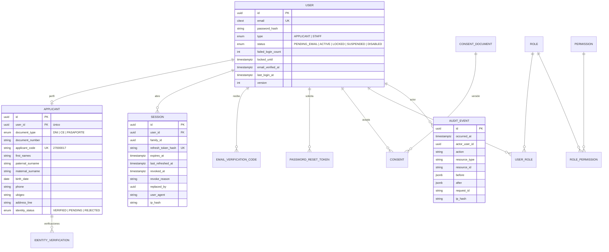
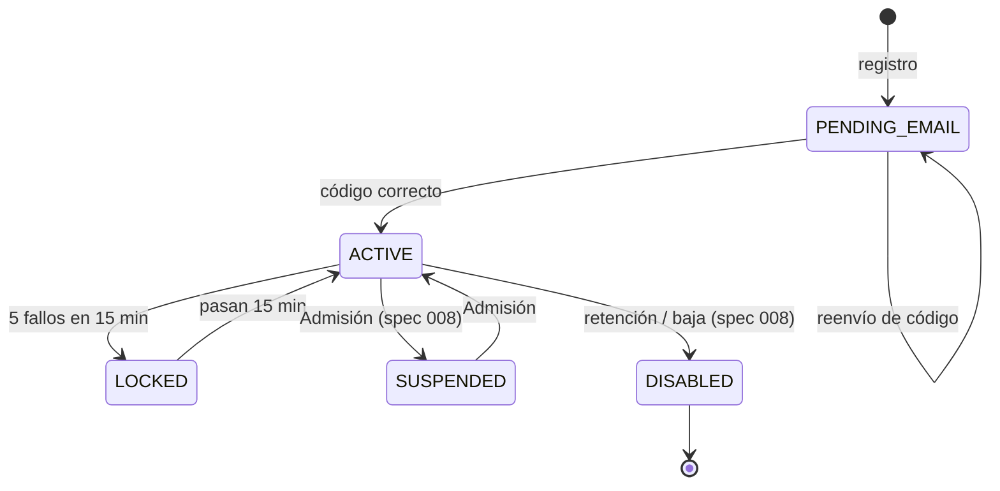
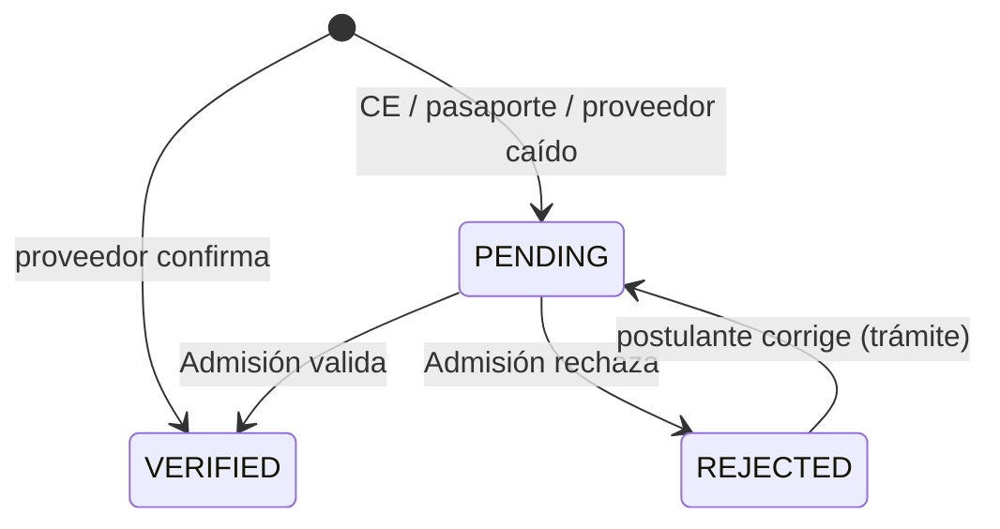

# Diseño — Cuentas del postulante e identidad

> **SDD (Spec-Driven Development) · artefacto 2 de 3: diseño** (cómo se construye).
> Anterior: [requirements.md](requirements.md) · Siguiente: [tasks.md](tasks.md). Arquitectura general: [docs/arquitectura.md](../../docs/arquitectura.md) y [ADR](../../docs/adr/README.md).


## 1. Plan técnico

**Rama:** `002-cuentas-identidad` · **Fecha:** 25/10/2026 · **Especificación:** [requirements.md](requirements.md)
**Artefactos:** [design.md](design.md) · [design.md](design.md) · [contracts/openapi.yaml](./contracts/openapi.yaml) · [design.md](design.md)

### Resumen

Cuenta única del postulante (MEJ-01) validada con su documento: registro en dos pasos (consulta de identidad con dígito verificador → creación de cuenta con los nombres del proveedor), verificación de correo por código, inicio y cierre de sesión con bloqueo por intentos, recuperación de contraseña, perfil con solo los datos de contacto editables y actividad de la cuenta.

Técnicamente: módulos **M02 Usuarios e identidad** y **M13 Seguridad** (sesiones, roles, padrón de inhabilitados, auditoría). Implementa ADR-006: JWT de acceso de 15 min en memoria y refresh token rotativo en cookie `HttpOnly`. Proveedor de identidad **simulado** (ADR-007). Deja listos los *middlewares* `authenticate` y `authorize` que usarán las funcionalidades 003–010.

### Contexto técnico

| Aspecto | Valor |
|---|---|
| Lenguaje / versión | TypeScript 5.x (`strict`), Node.js 22 LTS |
| Dependencias nuevas | `argon2`, `jose` (JWT), `cookie-parser` |
| Almacenamiento | PostgreSQL: esquemas `usuarios` y `seguridad` |
| Pruebas | Vitest, PostgreSQL embebido, Supertest, Playwright |
| Metas | Registro + verificación < 3 min (SC-001); login p95 < 500 ms incluido Argon2id |
| Restricciones | Sin datos personales en telemetría; mensajes que no revelan si una cuenta existe |
| Depende de | 001: `shared/*`, límites de uso, outbox, envío de correo por el worker |

### Verificación de la constitución

| Artículo | ¿Cumple? | Nota |
|---|---|---|
| I — Especificación primero | ✅ | 19 comprobaciones en `design.md` vinculadas a escenarios |
| II — Fidelidad institucional | ✅ | Identidad **simulada y etiquetada**; DNI sintéticos en un rango reservado |
| III — Monolito modular y Clean Architecture | ✅ | M02 usa a M13 solo por `index.ts` (consultar padrón, crear sesión, auditar) |
| IV — Stack aprobado | ✅ | — |
| V — Seguridad y privacidad | ✅ | Argon2id, rotación de refresh, anti-enumeración, consentimiento versionado, auditoría sin secretos |
| VI — UX móvil y accesible | ✅ | Formularios con etiquetas, errores asociados a cada campo, `autocomplete` correcto |
| VII — Definición de terminado | ✅ | Ver lista de cierre |
| IX — RNF | ✅ | RNF-02, 03, 10, 13 |

**Re-verificación tras el diseño (Fase 1):** ✅ sin cambios.

### Estructura del proyecto

```text
apps/backend/src/modules/
├── usuarios/
│   ├── domain/
│   │   ├── entities/        User, Applicant
│   │   ├── value-objects/   DocumentId, Email, Phone, Password (política), ApplicantCode (Luhn)
│   │   ├── rules/           canRegister, canEditField
│   │   └── ports/           IdentityProvider, UserRepository, ApplicantRepository,
│   │                        PasswordHasher, CodeGenerator, DisqualificationChecker
│   ├── application/use-cases/
│   │   LookupIdentity, RegisterApplicant, VerifyEmail, ResendCode,
│   │   RequestPasswordReset, ResetPassword, GetProfile, UpdateProfile, GetActivity
│   ├── infrastructure/      MockIdentityProvider, Argon2Hasher, Prisma*Repository
│   └── presentation/        auth.routes.ts, me.routes.ts, schemas.ts
└── seguridad/
    ├── domain/              Session (rotación, reutilización), Role, Permission, AuditEvent
    ├── application/         Login, Refresh, Logout, LogoutAll, IsDisqualified, RecordAudit
    ├── infrastructure/      JoseTokenService, Prisma*Repository
    ├── presentation/        middlewares: authenticate, authorize(permiso), requireOwner
    └── index.ts

apps/frontend/src/app/
├── core/auth/               AuthService (token en memoria), interceptor 401 → refresh,
│                            guard autenticado, temporizador de inactividad
└── features/
    ├── public/auth/         registro (2 pasos), verificar correo, ingresar, recuperar, restablecer
    └── postulante/          panel (vacío por ahora), perfil, actividad
```

### Fase 0 — Investigación

Completa en [design.md](design.md): registro en dos pasos (R-01), DNI sintéticos (R-02), anti-enumeración (R-03), contraseñas (R-04), tokens y sesiones (R-05), código de correo (R-06), recuperación (R-07), bloqueo (R-08), código de postulante con Luhn (R-09), documentos extranjeros y proveedor caído (R-10), consentimiento (R-11), actividad (R-12), pruebas (R-13).

### Fase 1 — Diseño

- **Modelo de datos:** [design.md](design.md). 14 tablas (7 en `usuarios`, 7 en `seguridad`); máquinas de estado del usuario y de la verificación.
- **Contratos:** [contracts/openapi.yaml](./contracts/openapi.yaml). 14 endpoints.
- **Validación:** [design.md](design.md).

#### Flujo de registro

```mermaid
sequenceDiagram
  autonumber
  actor P as Postulante
  participant W as Web
  participant API as API (M02)
  participant ID as IdentityProvider (simulado)
  participant SEC as M13 Seguridad
  participant DB as PostgreSQL
  participant WK as Worker
  P->>W: DNI + dígito verificador
  W->>API: POST /auth/identity/lookup
  API->>API: Límite de uso (IP y documento)
  API->>SEC: ¿inhabilitado?
  API->>ID: verificar(DNI, dígito)
  ID-->>API: nombres, nacimiento, vigencia
  API-->>W: nombres + identityToken (10 min)
  P->>W: confirma; correo, celular, contraseña, consentimiento
  W->>API: POST /auth/register
  API->>API: validar token, política de contraseña
  API->>DB: BEGIN · user(PENDING_EMAIL) · applicant + código · consent · código HMAC · audit · outbox(CodigoVerificacionSolicitado) · COMMIT
  Note over DB: UNIQUE(documento) evita duplicados concurrentes
  API-->>W: 201 (correo enmascarado)
  WK->>DB: outbox
  WK-->>P: correo con el código
```

#### Flujo de renovación de sesión con detección de robo



#### Middlewares que quedan disponibles para las demás funcionalidades

| Middleware | Uso | Respuesta si falla |
|---|---|---|
| `authenticate` | Valida el JWT y carga `req.principal` | 401 |
| `authorize('permiso')` | Verifica el permiso por rol | 403 |
| `requireOwner(cargarRecurso)` | Verifica que el recurso pertenece al postulante | **404** (ADR-006) |

#### Pantallas

| Ruta | Pantalla | Historias |
|---|---|---|
| `/registrarse` | Paso 1: documento · Paso 2: datos y contraseña | H1 |
| `/verificar-correo` | Código de 6 dígitos con reenvío | H2 |
| `/ingresar` | DNI o correo + contraseña | H3 |
| `/recuperar`, `/restablecer` | Solicitud y nueva contraseña | H4 |
| `/postulante/perfil` | Datos (identidad bloqueada, contacto editable), código de postulante, cerrar todas las sesiones | H5 |
| `/postulante/actividad` | Lista de eventos | H6 |

### Riesgos

| Riesgo | Mitigación |
|---|---|
| Argon2 compila un módulo nativo: el binario debe ser para Lambda ARM64 | Empaquetar en CI con la imagen de compilación de Lambda ARM64 y probar con `sam local` o un despliegue `dev` |
| Correos de SES en *sandbox* solo a direcciones verificadas | Verificar los correos del equipo y de los evaluadores antes de la presentación |
| El temporizador de inactividad solo en el navegador | Reforzado en el servidor con `last_refreshed_at` (R-05) |

### Seguimiento de complejidad

| Desviación de la constitución | Por qué es necesaria | Alternativa más simple descartada porque |
|---|---|---|
| — | — | — |

### Lista de cierre (definición de terminado)

- [ ] Todos los escenarios de `requirements.md` pasan en E2E.
- [ ] Prueba de concurrencia: 2 registros simultáneos del mismo DNI → 1 cuenta.
- [ ] Prueba de cada endpoint privado: sin token → 401.
- [ ] Prueba de reutilización de refresh token → familia revocada.
- [ ] Búsqueda de DNI y correo en la telemetría: 0 resultados.
- [ ] **Primer despliegue en AWS (`demo`)** de 001 + 002 y ejecución de los dos `design.md` contra la URL de CloudFront.

## 2. Decisiones técnicas (investigación)

**Funcionalidad:** `002-cuentas-identidad` · **Fecha:** 25/10/2026
**Base:** ADR-006 (autenticación), ADR-007 (proveedor de identidad simulado), research R-03 y R-08 de la funcionalidad 001 (reloj y límites de uso).

---

### R-01. Registro en dos pasos con token de identidad

**Decisión:**
1. `POST /auth/identity/lookup` recibe tipo y número de documento más el **dígito verificador** del DNI. Si el proveedor lo confirma, devuelve los nombres y un **token de identidad** firmado (JWT de 10 minutos) que contiene el documento y los nombres verificados.
2. `POST /auth/register` recibe ese token más correo, celular, contraseña y consentimiento. **Los nombres nunca se toman del navegador**: se leen del token.

**Justificación:** escenario 1.1 ("sin que yo los escriba") y RN-20; impide que alguien altere los nombres entre la consulta y el registro.
**Alternativas:** una sola llamada (peor experiencia: el postulante no confirma sus nombres antes de llenar todo); guardar la consulta en una tabla temporal (más estado sin beneficio).

### R-02. Proveedor de identidad simulado

**Decisión:** `MockIdentityProvider` lee `prisma/seed/identity/synthetic-dni.json` con **50 DNI sintéticos** en el rango **`99900001`–`99900050`**, cada uno con dígito verificador, nombres, fecha de nacimiento y vigencia. Incluye casos de prueba:

| DNI | Caso |
|---|---|
| `99900001`–`99900040` | Válidos y vigentes (mayores de edad) |
| `99900041`–`99900043` | Menores de edad (5.º de secundaria, RN-13) |
| `99900044` | DNI vencido → rechazado (RN-21) |
| `99900045` | Registrado en el padrón de inhabilitados (RN-09) |
| `99900046` | Proveedor "no disponible" (simula tiempo de espera) |
| `99900047`–`99900050` | Reservados para pruebas E2E |

La interfaz muestra la etiqueta **"Verificación de identidad simulada"** (Constitución II.3).
**Justificación:** permite probar todos los escenarios sin datos de personas reales.
**Alternativas:** usar DNI reales de compañeros (datos personales sin consentimiento: prohibido).

### R-03. Protección contra la enumeración de identidades

**Decisión:**
- La consulta exige el **dígito verificador**: sin él, conocer un número de DNI no basta para obtener nombres.
- Límite de **10 consultas por hora por IP** y **3 fallos por documento por hora**.
- La respuesta ante un documento inexistente o un dígito incorrecto es la misma: `IDENTITY_NOT_MATCHED`.
- Ante "DNI ya registrado" (escenario 1.3) se muestra el correo **enmascarado** (`d•••••@u•••.edu.pe`) solo si el dígito verificador fue correcto.

**Justificación:** SC-003 y protección de datos (RNF-03).

### R-04. Contraseñas

**Decisión:**
- Mínimo **10 caracteres**, máximo 128; se rechazan las 10 000 contraseñas más comunes (lista incluida en el paquete) y las que contienen el DNI o el correo.
- **Argon2id** con memoria 19 MiB, 2 iteraciones y paralelismo 1 (parámetros mínimos recomendados por OWASP); con 1 024 MB de Lambda, ~50–100 ms por verificación.

**Alternativas:** bcrypt (aceptable pero inferior frente a ataques con GPU); reglas de composición obligatoria (mayúsculas, símbolos) que empeoran la usabilidad sin mejorar mucho la seguridad.

### R-05. Tokens y sesiones (concreta ADR-006)

**Decisión:**

| Elemento | Valor |
|---|---|
| Token de acceso | JWT HS256, 15 min, *claims*: `sub`, `sid` (sesión), `typ` (`APPLICANT`/`STAFF`), `roles`. Se guarda solo en memoria del navegador |
| Clave de firma | 256 bits en SSM Parameter Store; rotación anual con `kid` |
| Refresh token | 32 bytes aleatorios, en cookie `__Host-sia_rt` (`HttpOnly; Secure; SameSite=Strict; Path=/`), guardado como SHA-256 |
| Rotación | Cada `POST /auth/refresh` emite uno nuevo y revoca el anterior; si se presenta uno ya rotado → se revoca **toda la familia** (robo probable) |
| Duración | 7 días para postulantes (8 h para personal, spec 008) |
| Inactividad (H3-E4) | Temporizador de 30 min en el navegador + el servidor rechaza el refresh si la sesión no se renovó en los últimos 30 min |
| CSRF | La cookie solo sirve en `/auth/refresh` y `/auth/logout`, que además exigen el encabezado `X-SIA-Client: web` |

**Justificación:** Lambda no guarda estado; revocación efectiva; mitigación de XSS (token corto) y CSRF.

### R-06. Verificación de correo

**Decisión:** código de 6 dígitos aleatorios, guardado como HMAC-SHA256; vence en **15 min**; **5 intentos**; reenvío con espera de **60 s** y máximo 5 por hora. El correo se envía por la outbox (ADR-008), con despacho inmediato después de la transacción para cumplir SC-001.

### R-07. Recuperación de contraseña

**Decisión:** token aleatorio de 32 bytes en un enlace `…/recuperar?token=…`, guardado como SHA-256, de **un solo uso** y **30 min**. La respuesta es idéntica exista o no la cuenta (escenario 4.1). Al cambiar la contraseña se revocan todas las sesiones (escenario 4.2) y se envía un aviso al correo.

### R-08. Bloqueo por intentos fallidos

**Decisión:** contador por cuenta: **5 fallos en 15 min → bloqueo de 15 min** y correo de aviso (escenario 3.2). Además, límite de 20 intentos por hora por IP para frenar ataques que prueban muchas cuentas. El mensaje de error de inicio de sesión no distingue entre usuario inexistente y contraseña incorrecta.

### R-09. Código de postulante

**Decisión:** **8 dígitos numéricos** = secuencia de 7 dígitos (empieza en `2700001`) + dígito de control **Luhn**. Ejemplo: el primero es `27000017` (secuencia `2700001` + dígito Luhn `7`).
**Justificación:** las entidades bancarias necesitan un código numérico corto para pagar (spec 005); el dígito de control detecta errores al dictarlo en ventanilla. No contiene datos personales.
**Alternativas:** UUID (impráctico en un banco); DNI como código (expone un dato personal en documentos públicos como la lista de admitidos).

### R-10. Documentos extranjeros e indisponibilidad del proveedor

**Decisión:** para carné de extranjería o pasaporte, y cuando el proveedor no responde (tiempo de espera de 10 s, RNF-08), el postulante escribe sus nombres y la verificación queda **`PENDING`**. Puede iniciar su inscripción, pero no confirmarla hasta que Admisión valide su identidad (spec 008).

### R-11. Consentimiento y datos personales

**Decisión:** el texto de tratamiento de datos se guarda versionado (`consent_documents`); el registro guarda versión, fecha y hash del texto aceptado (FR-009). El correo y el celular se muestran enmascarados en las respuestas que no son del propio titular. La política de retención (eliminar cuentas sin inscripción a los 12 meses del cierre de la convocatoria) se implementará en la spec 008 (RF-13.10).

### R-12. Actividad de la cuenta

**Decisión:** no se crea una tabla aparte: `GET /me/activity` lee `seguridad.audit_events` donde `actor_user_id` = usuario actual, y traduce cada acción a un texto amigable ("Iniciaste sesión desde un celular", "Cambiaste tu número de celular").

### R-13. Pruebas

| Nivel | Qué cubre |
|---|---|
| Unitarias | Política de contraseñas, Luhn, máquina de estados del usuario, rotación y reutilización de refresh tokens |
| Integración | Registro concurrente del mismo DNI → una sola cuenta (SC-002); bloqueo tras 5 fallos |
| Contrato | Respuestas conformes a `contracts/openapi.yaml`; mismas respuestas para cuenta existente e inexistente en recuperación |
| Seguridad | Ningún registro de telemetría contiene contraseña, código ni token (ADR-013); cookie con atributos correctos |
| E2E | Historias 1–4 en móvil: registro → código leído de `.dev-mail` → inicio de sesión → recuperación |

## 3. Modelo de datos

**Funcionalidad:** `002-cuentas-identidad` · **Fecha:** 25/10/2026
**Esquemas:** `usuarios` (M02) y `seguridad` (M13)

---

### 1. Diagrama entidad-relación



---

### 2. Esquema `usuarios` (M02)

#### `users`
| Columna | Tipo | Reglas |
|---|---|---|
| `email` | `citext` | Único, sin distinguir mayúsculas (FR-004) |
| `password_hash` | `text` | Argon2id (research R-04); nunca se devuelve en la API |
| `type` | enum | `APPLICANT` en esta funcionalidad; `STAFF` en la spec 008 |
| `status` | enum | Ver máquina de estados |
| `failed_login_count`, `locked_until` | `int`, `timestamptz` | Bloqueo temporal (R-08) |

#### `applicants`
| Columna | Tipo | Reglas |
|---|---|---|
| `document_type`, `document_number` | enum, `varchar(12)` | **Único** `(document_type, document_number)` (FR-004, SC-002). DNI: exactamente 8 dígitos |
| `applicant_code` | `char(8)` | Único; secuencia `usuarios.applicant_code_seq` desde 2700001 + dígito Luhn (R-09) |
| `first_names`, `paternal_surname`, `maternal_surname` | `varchar(80)` | **No editables** por el postulante (FR-011) |
| `birth_date` | `date` | Del proveedor de identidad |
| `phone` | `varchar(9)` | `CHECK (phone ~ '^9\d{8}$')` |
| `ubigeo`, `address_line` | `char(6)`, `varchar(200)` | Editables |
| `identity_status` | enum | `VERIFIED` (proveedor), `PENDING` (manual o proveedor caído), `REJECTED` |
| `guardian_name` | `varchar(160)` nulo | Opcional para menores (spec 003) |

#### `identity_verifications`
`applicant_id`, `provider` (`MOCK | RENIEC`), `result` (`MATCHED | NOT_MATCHED | EXPIRED_DOCUMENT | UNAVAILABLE | MANUAL`), `checked_at`, `checked_by` (nulo si es automática), `response_hash`. Historial de verificaciones; no guarda la respuesta completa del proveedor (minimización de datos).

#### `email_verification_codes`
`user_id`, `email` (al que se envió; sirve también para cambio de correo), `code_hmac`, `expires_at` (15 min), `attempts` (máx. 5), `consumed_at`, `sent_at`.

#### `password_reset_tokens`
`user_id`, `token_hash` (único), `expires_at` (30 min), `used_at`.

#### `consent_documents` y `consents`
- `consent_documents`: `version` (PK, p. ej. `2026-10-v1`), `text_md`, `text_hash`, `published_at`.
- `consents`: `user_id`, `version`, `accepted_at`, `text_hash`. Único `(user_id, version)`.

---

### 3. Esquema `seguridad` (M13)

#### `sessions` (refresh tokens con rotación)
| Columna | Reglas |
|---|---|
| `family_id` | Todas las rotaciones de un inicio de sesión comparten familia |
| `refresh_token_hash` | Único; SHA-256 |
| `last_refreshed_at` | Para la regla de inactividad de 30 min (R-05) |
| `revoked_at`, `revoke_reason` | `LOGOUT`, `LOGOUT_ALL`, `ROTATED`, `REUSE_DETECTED`, `PASSWORD_CHANGED`, `SUSPENDED` |
| `replaced_by` | Sesión que la sustituyó al rotar |

#### `roles`, `permissions`, `role_permissions`, `user_roles`
- Rol inicial: `APPLICANT` con permisos `me.read`, `me.update`, `applications.own` (para las specs 003+).
- Los roles del personal se agregan en la spec 008.

#### `disqualified_persons` (padrón de inhabilitados)
`document_type`, `document_number`, `reason`, `resolution`, `valid_from`, `valid_until` (nulo = definitivo). Índice por documento. En 002 solo se **consulta** (FR-003); la gestión es de la spec 008. La semilla de pruebas incluye el DNI `99900045`.

#### `audit_events`
| Columna | Reglas |
|---|---|
| `action` | `auth.login`, `auth.login_failed`, `auth.locked`, `auth.logout`, `auth.password_reset`, `account.created`, `account.email_verified`, `profile.updated`, `sessions.revoked_all` |
| `before`, `after` | Solo campos cambiados; **nunca** contraseñas, códigos ni tokens |
| Permisos | El rol de base de datos de la aplicación tiene `INSERT` y `SELECT`, **sin `UPDATE` ni `DELETE`** (RNF-10) |

---

### 4. Máquina de estados del usuario



- `PENDING_EMAIL` puede iniciar sesión **solo** para verificar su correo.
- `LOCKED` se calcula con `locked_until > ahora`; no hace falta una tarea programada para desbloquear.

### 5. Máquina de estados de la verificación de identidad



### 6. Índices y restricciones clave

| Restricción | Garantiza |
|---|---|
| `UNIQUE (document_type, document_number)` en `applicants` | Una cuenta por persona, incluso con registros simultáneos |
| `UNIQUE (email)` en `users` | Un correo por cuenta |
| `UNIQUE (refresh_token_hash)` en `sessions` | Detección de reutilización |
| `CHECK (attempts <= 5)` en `email_verification_codes` | Tope de intentos |
| Índice `(actor_user_id, occurred_at DESC)` en `audit_events` | Actividad de la cuenta rápida |

## 4. Guía de validación

**Funcionalidad:** `002-cuentas-identidad`
**Requisito previo:** entorno de [001](../001-portal-publico/design.md) preparado (`npm.cmd run db:setup`, que también carga los 50 DNI sintéticos `99900001`–`99900050` y el padrón de prueba).

```powershell
npm.cmd run dev
```

Los correos se guardan como archivos `.html` en `apps/backend/.dev-mail/` y se resumen en la consola de la API (ADR-014). Los DNI sintéticos y su dígito verificador están en `apps/backend/src/modules/usuarios/infrastructure/synthetic-identities.ts`; la pantalla de registro muestra algunos en «Datos de prueba».

### Validaciones

| # | Acción | Resultado esperado | Valida |
|---|---|---|---|
| 1 | *Crear cuenta* → DNI `99900001` con su dígito | Se muestran nombres y apellidos sin escribirlos; etiqueta "Verificación de identidad simulada" | H1-E1 |
| 2 | Completar correo, celular, contraseña de 10+ caracteres y aceptar datos personales | Cuenta en "Correo sin verificar"; código de 6 dígitos en `.dev-mail`; se ve el código de postulante | H1-E2 |
| 3 | Intentar enviar sin aceptar el tratamiento de datos | Botón deshabilitado | H1-E5 |
| 4 | Registrar otra vez `99900001` | "DNI ya registrado", correo enmascarado y enlace a recuperar | H1-E3 |
| 5 | Registrar `99900045` | No permite continuar; indica acudir a la Dirección de Admisión, sin motivo | H1-E4 |
| 6 | Registrar `99900044` | "Documento vencido" | RN-21 |
| 7 | Registrar `99900046` | Tras ~10 s permite escribir nombres; cuenta con identidad "Pendiente de verificación" | Caso límite |
| 8 | Ingresar el código correcto | Cuenta activa | H2-E1 |
| 9 | Ingresar 5 códigos erróneos y un sexto | El código se invalida; hay que pedir otro | H2-E2 |
| 10 | Pedir reenvío dos veces en menos de 60 s | Se pide esperar | H2-E3 |
| 11 | Iniciar sesión con el DNI y luego con el correo | Ambos entran al panel | H3-E1 |
| 12 | Fallar 5 veces la contraseña y probar otra vez | Cuenta bloqueada 15 min; correo de aviso | H3-E2 |
| 13 | Cerrar sesión y pulsar *Atrás* | No se ve información privada | H3-E3 |
| 14 | Con `APP_FIXED_NOW`, avanzar 31 min sin actividad y navegar | Pide iniciar sesión de nuevo | H3-E4 |
| 15 | *¿Olvidaste tu contraseña?* con una cuenta existente y otra inexistente | Mismo mensaje; solo la existente recibe enlace | H4-E1 |
| 16 | Usar el enlace y cambiar la contraseña con dos sesiones abiertas | Ambas sesiones se cierran; el enlace no sirve dos veces | H4-E2 |
| 17 | En *Mi perfil*, cambiar celular y correo | Celular guardado; el correo nuevo pide verificación | H5-E1 |
| 18 | Intentar editar nombres o DNI (también por API con `PATCH /me`) | Campos no editables; la API responde 422 | H5-E2 |
| 19 | Abrir *Actividad* | Inicios de sesión, fallos y cambios con fecha y hora | H6-E1 |

### Pruebas automáticas

```powershell
npm.cmd run test -w apps/backend -- auth usuarios     # unitarias + integración (registro concurrente)
npm.cmd run test:contract -w apps/backend             # contra contracts/openapi.yaml
npm.cmd run e2e -w apps/frontend -- cuentas           # Historias 1–4 en móvil
```

### Comprobaciones de seguridad

- En las herramientas de desarrollo del navegador, la cookie `__Host-sia_rt` aparece como `HttpOnly`, `Secure` y `SameSite=Strict`; el token de acceso no está en `localStorage`.
- En la salida de la API, buscar el DNI y el correo usados: **0 resultados** (ADR-013).
- `SELECT * FROM seguridad.audit_events` no contiene contraseñas, códigos ni tokens.

## 5. Contratos de la API

- [contracts/openapi.yaml](contracts/openapi.yaml)

## 6. Actualizaciones de diseño (27 y 28/10/2026)

- **RENIEC con apiperu.dev** (RF-02.02): adaptador `ApiPeruIdentityProvider` (`apps/backend/src/modules/usuarios/infrastructure/apiperu-identity-provider.ts`) → `POST https://api.apiperu.dev/dni` con `Authorization: Bearer`. Configuración: `IDENTITY_PROVIDER=apiperu` y `APIPERU_TOKEN` (solo en el servidor). Comprobación: `npm run apiperu:check <DNI>`.
- La consulta distingue **no encontrado** (el postulante escribe sus nombres) de **servicio no disponible** («No pudimos consultar RENIEC en este momento»); nunca bloquea la inscripción.
- `GET /inscriptions/options` informa `identitySimulated`: el recuadro de DNI de prueba solo aparece con identidades simuladas.
- Personal: `scripts/staff-status.ts` (estado de cuentas, solo lectura) y `scripts/staff-reset.ts` (contraseña temporal, conserva el TOTP).

## 7. Ingreso del postulante rediseñado (30/10/2026, skill interface-design)

- **Tarjeta dividida** (`features/cuenta/login.ts`) para «Ingresar», «Recuperar contraseña» y «Nueva contraseña»: a la izquierda, en guinda, «Tu cuenta de postulante» con lo que la cuenta permite hacer (ver las inscripciones sin el código, actualizar correo y celular, revisar la actividad reciente) y la salida para quien se inscribió sin cuenta («Mi inscripción» con DNI y código); a la derecha, el formulario con título y texto propios de cada paso.
- **Detalles de uso**: mostrar u ocultar la contraseña (`aria-pressed`), aviso de mayúsculas activadas, contador de 10 caracteres en la contraseña nueva, botón desactivado sin el enlace del correo, «Crear cuenta» separado de «Olvidé mi contraseña». Misma línea que el ingreso del personal (spec 008).
- **Celular** (≤ 860 px): primero el formulario y después la explicación; sin desborde a 375 px.
- **Mi cuenta como resumen** (30/10/2026, `features/cuenta/my-account.ts`): saludo con el documento enmascarado y la insignia de identidad; «Cerrar sesión» discreto y «en todos mis dispositivos» como enlace. Inscripciones a la izquierda (cada una con su línea del trámite) y, a la derecha, datos de contacto (el botón se activa solo con cambios) y actividad reciente como línea de tiempo. Se corrigió el refresco tras pagar: la página escuchaba el evento `paid`, que la constancia ya no emite; ahora usa `updated`. Verificado con una sesión simulada en el navegador (escritorio y 375 px).
